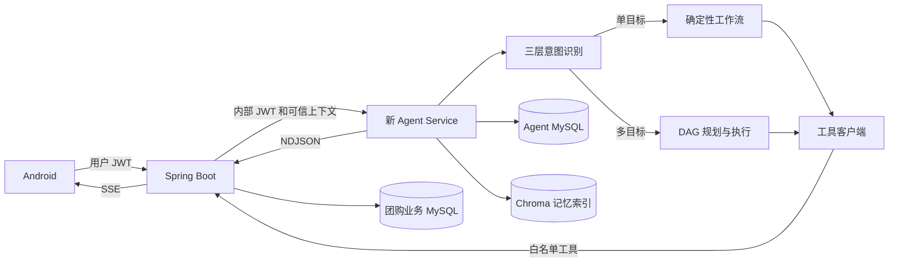

# 饭搭子 AI 团购化与独立 Agent 服务重构设计

## 1. 状态、范围和文档职责

- 修订日期：2026-10-02。
- 本文是目标规格；实施计划记录任务、前置条件和完成状态，UI 文档记录设计与视觉容差，验收报告记录实测证据。
- 手机项目：`C:/Users/caid0/Documents/ChatGPT/手机agent/.worktrees/fandazi-ai`。
- 新 Agent 项目：`D:/project/-Demo-master`。
- 旧 Agent：手机项目 `agent-service/`，保留源码，最终退出默认运行路径。现有实现可作为迁移参考，但不能算作新 Agent 已接入。
- UI 文档：`D:/project/-Demo-master/docs/ui-design/ui-design-spec.md`。
- Figma：`https://www.figma.com/design/FxsWKGs10z7BL1MhFAOqFN`。
- 既有决策来自 `.scratch/group-buying-refactor/grilling/session.md` 的 Q1–Q76；本次补入核销暂缓、Task8 人工设计确认及轻微 UI 差异可接受的后续决定。
- 最新明确的用户决定优先于历史文档；设计示例、代码现状和历史测试通过都不能自行改变产品范围。
- 原实施记录归档到 `docs/verification/group-buying-refactor-history-2026-10-01.md`，不作为当前可执行计划。
- 2026-10-02补正：后续按 Task4 → Task5 → Task6 → Task7 → Task8 → Task9 → Task10 → Task11 → Task12 逐任务收尾；端侧离线 ASR 按用户最新决定延期。本次只修改文档，不恢复开发或验收。
- 后续执行授权：用户已明确要求从 Task4 连续执行至 Task12，现开始 Task4；上述“只修改文档”仅记录此前文档修订，不再表示当前开发仍暂停。各任务仍须独立验收，不跳过 Task4–7 直接恢复 Task8。

### 1.1 本期交付与延期

本期交付：浏览门店与套餐、账号密码认证、AI 文字与卡片、真实工具调用、购买确认、模拟支付、团购券查询、退款申请与待处理进度、文字评价、FAQ、投诉、优惠券只读查询、长期记忆及用户管理入口。

核销二维码、模拟商家核销和核销结果页面暂缓；`UI-13/14` 的设计与既有代码保留，不作为本期完成条件。退款审核、到账、真实支付、商家端和照片评价也不在本期范围内。以后恢复延期功能时另列实施和验收步骤。

端侧离线 ASR 同样延期，不计入本期 Task5 或 Task12 验收条件。历史 Sherpa-ONNX/Paraformer 方案保留为后续参考；系统 `SpeechRecognizer`、麦克风图标或模拟文本回填均不能作为已部署本地模型的证据。以后恢复时另补模型、录音、聊天回填、Figma 交互和真实离线验收，不在当前任务中隐式实施。

评价资格仍要求订单至少有一张已核销券且尚未评价。本期通过后端开发库夹具准备此类订单，验证评价功能；不在 Android 增加假核销按钮或放宽资格。

### 1.2 当前偏差，不能当作已完成事实

2026-10-01 初次核查发现旧启动入口和等待输入协议差异。现 Task1/3 已补正并独立验收 PASS，实际入口为新项目 `service.app:create_app`、协议 1.1、Spring 调用 8091；旧 `agent-service` 保留但不运行。完整证据见手机 `docs/verification/2026-10-01-task3-independent-acceptance.md`。Task2 于 2026-10-02 独立验收 PASS，真实 V13 的金额、编号、时间、页面字段与夹具已核查；当时完整后端有一项旧卡片文案失败，外部餐图有偶发超时，交由 Task8 处理。Task8 开发回归已修复旧文案优先级并实际通过后端200/200，但独立验收和页面收尾尚未完成，不能以新入口、字段或开发测试通过代替它。

## 2. 产品目标与业务闭环

将 Android 外卖 App、Spring Boot 和旧 Python Agent 重构为餐饮到店团购 App、团购业务后端和独立新 Agent 服务。

本期闭环：

```text
发现门店与套餐 → 查看详情 → 后端报价 → 用户确认 → 模拟支付
  → 生成并查询团购券 → 申请退款 / 查询待处理进度
  → 对具备核销事实的夹具订单发表评价
```

Agent 通过 Spring Boot 白名单工具访问业务事实，Android 只连接 Spring Boot。新 Agent 不可用时，公开浏览、购买与订单仍能使用，AI 页面显示错误和重试入口。

## 3. 非目标

- 不扩展餐饮以外品类，不做代金券和商圈。
- 不保留配送、骑手、收货地址、配送费、起送价和外卖购物车的默认运行依赖。
- 不做真实支付、真实退款到账、真实客服时限承诺及本期核销终端。
- Agent 返回文字或聊天卡片；页面跳转由用户点击触发。
- 新 Agent 故障时不恢复旧 Agent 流量。
- Android 不写死门店、套餐、价格、库存、订单、资格、账户或业务状态；固定导航、字段标签和设计规定的静态文案允许保留。
- 本期 AI 使用文字输入，不新增语音录制、ASR 模型打包、实时转写或语音播报；保留历史代码不表示语音功能已交付，正式页面不得提供误导性的可用语音入口。

## 4. 架构、项目边界和运行来源



| 组件 | 权威职责 |
|---|---|
| Android | 完整页面、登录门槛、文字与卡片、用户确认、定位权限 |
| Spring Boot | 身份和会话归属、业务事实、工具校验、确认凭证、幂等、会话原文、卡片补全 |
| 新 Agent | 意图、工作流、DAG、响应组织、长期记忆、Agent 审计 |
| 手机业务 MySQL | 用户、品牌、门店、套餐、订单、券、退款、评价、投诉、会话原文 |
| Agent MySQL | 记忆主记录、意图、计划、运行和工具审计 |
| Chroma | 可从记忆主记录重建的语义索引 |

最终启动、Compose、CI 和健康检查必须指向新 Agent 项目。健康检查返回服务标识、构建版本和协议版本，验收同时核对进程入口；仅返回 HTTP 200 不能证明新服务已经接入。

## 5. 页面与设计基线

底部导航固定为首页、AI助手、订单、我的，使用房屋、机器人、订单单据和用户轮廓图标。选中态为珊瑚橙，未选中态为辅助灰；不使用圆点占位、旧圆形底板或第五项导航。

- 首页：位置、搜索、横向分类、人均/距离/筛选和真实门店列表；没有 AI 横幅或悬浮球。
- 分类：推荐、奶茶咖啡、快餐小吃、火锅、烧烤烤肉、地方菜系。距离右侧为漏斗筛选按钮；无位置权限时仍可浏览，不启用精确距离排序。
- 门店：优惠、菜品、评价三个 Tab；不提供外卖加购。
- 套餐：独立详情、套餐内容、规则、固定购买操作；无搜索、收藏、分享、更多和购物车入口。
- 下单：底部确认弹窗，显示套餐、数量、总价、活动优惠、实付；不含秒杀、神券包、美团券或商家券。
- 游客：可浏览公开内容；AI、购买和受保护功能引导登录，登录后回到原入口。
- 登录/注册：账号密码，无验证码；游客“我的”只有登录/注册和设置。
- AI：一个 `AgentChatFragment`，按状态显示消息、进度、卡片、登录提示和错误；“问 AI”可携带用户选择的门店或套餐上下文。

### 5.1 当前设计确认与交付状态

| Frame 范围 | 设计确认 | 本期要求 |
|---|---|---|
| UI-01–12 | 已确认 | 实现并验收；历史通过需与当前版本核对 |
| UI-13–14 | 设计保留 | 核销延期，不计本期验收 |
| UI-15H | 已确认 | 游客拦截，禁止展示套餐结果 |
| UI-15A–G、I–J | 当前文档尚无完整最终确认记录 | 核对已确认记录，缺少的状态再补确认 |
| UI-16 | 待确认 | 游客“我的” |
| UI-17A/B | 已确认 | 账号密码登录/注册 |
| UI-18A/B、19、20A/B、21A/B/C | 2026-10-01 用户人工设计验收通过 | 实现待复验，不重复要求确认相同设计 |
| AI 记忆页 | 尚无已确认稿 | Task10 先补设计 |

原 35 张基础 Frame 是设计清单，不是永久固定的验收数量。交互派生状态、售后聊天状态和记忆页登记到状态清单；延期项明确排除。设计确认与 APK 实现验收分别记录。

### 5.2 UI 验收容差

用户已确认：大小或颜色差一点点可以接受，不要求完全一致。验收以正常观看下结构清楚、可读、可操作和整体风格接近为准，不以截图逐像素差异或固定色差阈值判失败。

| 情况 | 判定 |
|---|---|
| 轻微尺寸、间距、圆角、字体渲染、图标线条细节差异；同一色系轻微颜色差异 | 可接受，最多记为非阻塞建议 |
| Android 状态栏、键盘、系统字体与设计示例的合理差异 | 可接受 |
| 后端门店名、金额、时间、图片内容与设计样例不同 | 可接受；必须是真实字段且布局容纳实际内容 |
| 缺少核心区块、严重比例偏差、错误导航/选中态、文字溢出或重叠、控件不可点、结果伪造 | 阻塞，必须修复 |
| 用圆点代替正式图标、页面仍保留外卖字段、缺少确认与错误恢复路径 | 阻塞，必须修复 |

已确认 Figma 页面在实施期间保持基线稳定。轻微视觉建议不触发重新设计或重复验收整组页面。新增功能、字段或交互状态才登记设计变更。

## 6. 领域、金额和页面数据契约

核心实体：品牌、门店、固定套餐、套餐适用门店、购买报价、团购订单、券、退款申请、评价、优惠券与用户优惠券、投诉、确认凭证、Agent 消息。

业务资源对外使用不可枚举 UUID `publicId`，内部主键不下发。Task2 的 V13 将原 store-001 等非随机编号映射到随机第四版 UUID，持久化 legacy 别名供迁移和种子内部引用，不对公开目录 API 开放别名入口；内部数值外键和归属保持不变。旧报价/确认失效后须重新取得明确授权，历史 JSON 只按明确资源字段转换，不替换用户正文。该实现已独立验收 PASS；任何编号格式都不能代替归属授权。

金额继续采用已确认的边界：数据库使用 `DECIMAL`，协议使用整数分，由 Spring 严格转换，禁止浮点金额参与校验。Task2 的 V12 新列由实体实际读写，原整数分列保留历史值且放宽可空，不做双写，不作为新记录金额权威；破坏性清理留到 Task11。订单支付快照、券稳定商加余数分摊和退款申请快照保持精确，未支付券金额为 null；历史实付可由既有支付状态证明时回填，但没有实际支付时间则保留 null，不伪造。

时间目标为带时区的 UTC ISO-8601，Android 转换为 Asia/Shanghai。旧 LocalDateTime 按明确上海业务时区转为 UTC 瞬间，不直接补 Z 或截断字符串；新创建时间在业务边界对齐数据库微秒精度，保证首返与回读一致。Task2 开发记录见 `docs/verification/2026-10-01-task2-contract-development.md`；独立 PASS 证据见 `docs/verification/2026-10-01-task2-independent-acceptance.md`，包含实际 MySQL 与 HTTP 时间核对，不代表 Android 展示已验收。

### 6.1 页面必需字段

| 页面/状态 | 后端负责的展示字段 | 缺失处理 |
|---|---|---|
| 首页/搜索门店列表 | publicId、name、category、averageSpendCents、rating、reviewCount、distanceMeters、imageUrl/imageAlt、featuredDeal；城市选项来自目录接口 | 评价尚不存在时不补评分，未知定位不补距离，无可售套餐不造推荐摘要；读取失败原地重试 |
| 门店三 Tab | 门店实际信息、营业时间、电话地址、真实可售套餐、关联菜品、公开评价、reviewDistribution | 菜品/评价/套餐无数据时显示对应空态，不拿设计样例补齐；评价统计不能把最新列表条数当全量数量 |
| 套餐详情与选项切换 | 当前 dealPublicId、storePublicId、title、description、价格、库存、有效期、购买限制、图片；同店其他套餐由接口读取 | 切换后内容和后续操作必须沿用新选中 ID，读取失败保留上下文供重试，不回退到固定经典套餐 |
| 订单列表与详情 | orderId、storeName、dealTitle、quantity、totalCents、createdAt、status、vouchers、canReview | 核心字段缺失按协议错误处理，可原地重试 |
| 退款申请 | voucherId、orderId、storeName、dealTitle、可退款金额、canRefund、有效期 | 无资格关闭入口；无金额不得确认 |
| 退款进度 | requestId、订单/套餐摘要、申请金额、原因、createdAt、status | 不把 REQUESTED（待处理）展示为已到账 |
| 发布评价 | orderId、门店/套餐摘要、createdAt、canReview | 资格不满足时关闭提交入口 |
| FAQ/投诉 | FAQ 分类、问题和答案；投诉类型目录、可选本人订单、提交结果 | 读取失败显示重试，不补静态业务答案或假订单 |
| 售后聊天卡 | 候选券公开摘要；确认动作、资源、金额、原因、过期时间 | 缺少确认关键字段时不能执行写操作 |
| 套餐/订单餐图 | 后端 imageUrl 及必要替代文本 | 无图或加载失败显示统一视觉占位；不拿另一套餐固定餐图冒充 |

数据准备阶段必须覆盖一条真实图片加载路径和缺图路径。图片内容无需与 Figma 示例相同，图片区域、比例和裁切应符合页面结构。

Task4 浏览接口使用 `GET /api/stores`，城市、关键词、分类、人均范围和排序分别作为独立参数；有效条件取交集，排序由后端完成。`minPrice/maxPrice` 是整数分，人均非法或倒置范围明确拒绝。距离排序必须有有效经纬度，未取得位置时提示补充位置，不伪造默认坐标。公开门店详情、关联套餐、菜品和评价沿用当前门店 UUID；城市选项来自 `GET /api/stores/cities`，菜品来自 `GET /api/stores/{publicId}/dishes`。目录只有城市代码而没有可信地名时可展示代码或“选择城市”，不得把设计图中的“北京市·朝阳区”当真实位置。

公开页面聚合字段与现有 17 个 Agent 工具的精简输出分别管理，不能因为增加页面展示字段就改变工具契约。`rating/imageUrl/featuredDeal/distanceMeters` 的空值表示缺少对应事实；`reviewDistribution` 顺序是一星至五星，全量评价统计与公开最新评价列表是不同指标。页面新增字段仍须实际接口、Android 和独立验收核对；本节同步设计依据不代表 Task4 已通过。

退款金额来自支付快照在券粒度上的分摊，不能读取变化后的套餐现价；券金额合计与订单实付一致。价格、库存、金额和资格在写入时由后端再次校验。

### 6.2 当前支持的状态

订单 API 使用 `PENDING_PAYMENT/PAID/PARTIALLY_USED/USED/REFUNDED/EXPIRED/CANCELLED`；UI 将 `USED` 显示为“已完成”，不混用另一个 `COMPLETED` 协议值。

券 API 当前使用 `UNUSED/REDEEMED/REFUNDED/EXPIRED`。退款申请本期返回实际领域与工具契约一致的 `REQUESTED`，界面显示“申请已提交、待处理”；申请后禁止重复申请，不能伪造已退款、审核失败或到账。原草案中的 `PENDING` 是待处理语义描述，不再作为协议状态使用。后续审核与 `REFUNDING` 状态另立迁移和契约变更。

退款要求本人已支付订单中的未核销券、未有重复申请及其他后端资格；评价要求本人订单至少一张已核销券且每订单只能评价一次。

退款进度不能仅依赖首次提交回执或 Android 页面内存。普通页面提供 `GET /api/refunds/by-voucher/{voucherId}`：先复核本人券，再读取该券唯一持久化申请；有申请时响应与按 requestId 查询完全相同，无申请返回404，他人资源与未认证请求拒绝。客户端只据真实响应显示“查看退款进度”，不能从 canRefund=false 推测申请存在；不改变17工具契约或新增退款审核能力。

## 7. 跨服务协议与聊天状态

手机项目根目录 `contracts/` 是权威来源；新 Agent 使用 `config/contracts/` 受控副本与 SHA-256。规格列出目标语义，Task1 修订契约后再同步三端，不能只修改本文就宣称协议已生效。

### 7.1 目标协议修订

当前契约 1.0 缺少等待补充信息。本次目标修订为 `schemaVersion: "1.1"`，仍使用 `agent-protocol-v1.yaml` 文件名。同步新增状态、事件、准备工具和字段定义，更新受控副本、摘要和兼容测试。

Spring 调用 `POST /internal/v1/agent/runs`，携带短期内部 JWT，接收 NDJSON。请求字段统一为 `query`，不同时使用 `text` 作为另一个权威字段。

```json
{
  "schemaVersion": "1.1",
  "userId": "user-public-id",
  "sessionId": "session-public-id",
  "traceId": "trace-uuid",
  "runId": "run-uuid",
  "query": "帮我申请退款",
  "context": {
    "page": "AI",
    "cityCode": "310000",
    "timezone": "Asia/Shanghai",
    "selectedStoreId": null,
    "selectedDealId": null,
    "clientCapabilities": ["TEXT", "CARD_V1", "CONFIRMATION_V1"]
  }
}
```

身份、会话归属、上下文资源及降精度位置由 Spring 校验。Spring 为首次任务分配 runId，补充信息和确认恢复沿用原 runId；每次用户输入产生新的 traceId。客户端和模型不决定归属、价格、授权或幂等键。

### 7.2 状态与事件

| 运行状态 | 含义 | Android 行为 |
|---|---|---|
| running | 正在处理 | 展示真实进度，防止重复发送 |
| waiting_input | 缺少选券、原因等用户输入 | 展示问题或候选卡，允许补充，不显示失败 |
| waiting_confirmation | 已有完整动作摘要，等待明确确认 | 展示确认卡；不提前写入 |
| succeeded | 已取得实际结果 | 展示回复/卡片，结束活动进度 |
| failed | 工具、服务或协议失败 | 可理解的错误和合适的重试；保留用户问题 |
| cancelled | 用户取消或任务取消 | 结束等待，不继续写入 |

事件使用 `eventType`、`eventId`、`sequence`、`traceId`、`runId`、`status` 和 `payload`。事件名统一为 `run_started/intent_decided/progress/text_delta/card/input_required/confirmation_required/tool_result/run_completed/error`。

`input_required` 结束本轮请求并暂停任务；`confirmation_required` 暂停等待确认；`run_completed` 结束任务，状态为 succeeded 或 cancelled，不能用于仍需输入/确认的任务；失败以 error 和 failed 终态结束。事件名称不代替状态判断。传输中断和结构不合法必须产生可定位错误，不默认为 succeeded。

进度按 runId 和步骤标识合并，显示用户可理解的名称和状态；不暴露协议英文状态、内部推理或固定耗时承诺。进入等待输入、等待确认或终态后停止活动加载动画。

### 7.3 卡片与兼容边界

卡片使用 `cardType`：store、deal、order、voucher、coupon、review、confirmation、error。售后选券使用 voucher 卡和 select_voucher 动作，退款/投诉使用 confirmation 卡和具体动作，不再把售后数据塞进外卖 CandidateCart。

模型只能引用工具公开资源；展示金额、资格、状态和可执行动作由 Spring 补全。确认卡公开动作摘要，不把确认凭证当作展示数据。用户点击后发起受控操作。

旧 `text/type/confirmationGrant/after_sale_refund` 等字段如需兼容，只在命名明确的适配器转换到权威字段，配兼容测试；新业务路径不再扩散旧字段。

## 8. 工具、确认和幂等

意图表示目标，工具表示原子能力，两者不一一对应。

| 工具 | 类型 | 执行前用户确认 |
|---|---|---|
| search_stores、get_store_detail、list_deal_packages、get_deal_detail、search_reviews | 只读 | 否 |
| list_user_orders、get_order_detail、list_user_vouchers、query_coupon、query_faq | 只读 | 否 |
| create_purchase_quote | 价格计算与购买确认准备 | 否 |
| prepare_refund、prepare_complaint | 资格校验与确认准备，不提交业务动作 | 否 |
| create_group_buy_order、pay_mock_order、request_refund、submit_complaint | 业务写操作 | 是 |

原 15 工具契约需补入两个准备工具，共 17 项；不增加意图数量。准备工具不等同于业务只读：它会签发短时确认凭证，需身份、资源归属、限流和审计。

统一入口为 `POST /internal/v1/tools/{toolName}`。确认字段统一为 `confirmationGrantId`；凭证绑定用户、会话、动作、资源、金额、版本、有效期且只能消费一次。

错误码为 VALIDATION_ERROR、NOT_FOUND、FORBIDDEN、CONFLICT、EXPIRED、RATE_LIMITED、DEPENDENCY_UNAVAILABLE、INTERNAL_ERROR。执行器生成 runId + taskId + actionVersion 幂等键，后端核对请求指纹；模型不生成幂等键。写结果不确定时先查询事实，不盲目重发。

## 9. 意图、DAG 和售后流程

团购版保持 12 类：
`greeting/chitchat/store_recommendation/deal_recommendation/store_info/review_query/group_buy_order/coupon/refund_after_sale/complaint/faq/out_of_scope`。

识别顺序为本地精准整句规则 → decision-model-preview → 重型模型分类兜底 → out_of_scope。一次决策请求判断 is_composite 和 intent；复杂任务 plan 由重型 Planner 生成并校验。

Task3 负责在新服务接入阶段完成这 12 类的最小迁移：配置、输出模型、两个分类模型、工作流映射及 Planner/Validator 使用相同名称，并有基础边界与复合请求测试。Task8 的真实售后识别依赖此项；Task9 只扩充完整模板、千级审核文案与评测，不承担延后的基础迁移。

is_composite 按独立目标数判断，不按工具数判断。单目标可连续调用多个工具；多个独立目标才进入 DAG。失败节点阻断依赖下游，独立只读分支可继续；写节点失败或结果不确定时停止本轮后续写操作，先查询业务事实。分别报告成功、失败和未执行项。

退款流程：查询本人可退券 → 用户精确选券 → 填原因 → 后端准备 → 确认摘要 → 明确确认 → 提交申请 → 展示真实 REQUESTED（待处理）。不得把预留审核/到账设计当成本期业务事实。
投诉流程：选类型 → 填描述与可选本人订单 → 后端准备 → 确认摘要 → 明确确认 → 展示真实提交结果。

补充输入为空白或超长时，保持原槽位的 waiting_input，提示字段限制，不污染检查点、不执行准备或写入。后端明确拒绝写入与提交响应丢失必须区分：前者保留失败终态但不误报结果不确定；后者保留核查状态，重复请求也不能自动重发。复合 DAG 的独立成功只读结果仍可展示，失败节点的依赖下游不执行，不发布私有准备凭证。

FAQ 分类和投诉类型目录由真实 Spring 接口提供；分类与搜索取交集，query_faq 工具保持既定三字段输出，不把页面专用字段扩散到工具契约。UI-21B 的验证由 development 显式故障开关对本人下一次订单读取产生一次 503，默认关闭，prod/production 不创建组件，不修改任何业务数据；重试后恢复真实查询。框架 ERROR 内部分发不得把真实 503 覆盖成 401，但直接 /error、未认证订单与故障入口仍受普通认证约束。

query_coupon 只读本人领取记录。status 是当前只读展示状态：已持久化 USED/EXPIRED 等历史终态优先；原 AVAILABLE 仅在启用且上海当前日期落于含首末日的有效期内仍为 AVAILABLE，到期为 EXPIRED、当前停用为 DISABLED、尚未生效为 NOT_YET_VALID。仅计算结果，不修改领取状态；安卓显示中文状态，不据日期自行授予可用资格，也不新增抵扣行为。

取消、凭证过期、资格变化、重启恢复、无候选券和写入结果不确定均有明确分支；不经过关键词捷径绕过三层识别或模型规划。

## 10. Agent 长期记忆

长期记忆仅指 Agent 跨会话提取和复用的记忆。会话原文与业务事实属于 Spring，不能被记忆替代。

允许记忆：菜系/口味/预算/人数/距离偏好、聚餐情景、推荐反馈、回答与排序偏好。健康、过敏、宗教饮食必须明确确认并标敏感；实时价格、库存、订单、支付、精确位置和一次性请求不写入记忆。

普通偏好仅在用户明确要求“记住”时直接保存；重复出现只能形成待确认建议，用户确认后才写入有效记忆。敏感信息仍需明确确认。记录来源、确认状态、置信依据和更新时间；待确认、冲突未解决和过期记录不得注入提示词或作为已知事实召回。

Agent MySQL memory_items 是主记录，Chroma 保存 memoryId、检索文本、embedding 和元数据，可重建。稳定画像少量注入，情景/反馈/程序偏好按问题检索 Top-K，会话使用最近消息与压缩摘要。

TTL：稳定偏好一年、情景 90 天、程序偏好 180 天、敏感信息 90 天。用户在“我的 → AI 记忆”查看、纠正、删除和全部清除；页面须先有已确认设计。

删除/清空须同步清理 MySQL 主记录、Chroma 索引与缓存；索引清理失败进入可重试补偿，但删除生效后任何检索或缓存路径都不能继续召回该内容。重启、索引重建和补偿重试不得恢复用户已删除的记忆。

## 11. 安全、标识与观测

- Spring 使用短期内部 JWT；静态开发凭据不得进入提交。
- Agent 使用服务凭据访问工具并携带用户、会话和链路标识；不直连业务数据库。
- sessionId 表示会话；traceId 表示一次输入；runId 表示可暂停任务；planId 表示一版 DAG，重新规划更新，简单任务为空。
- 审计失败不能改变业务结果，必须输出可定位日志与指标。
- 指标覆盖意图层调用率、分类准确率、计划合法率、工具/卡片成功率、确认拒绝率、记忆命中、任务成功和 P50/P95。
- 性能为观察目标：本地 P95 < 50ms，首事件 < 1s，简单只读 P95 < 8s，复合 P95 < 20s；没有实测不宣称达标。

## 12. 迁移与种子数据

已执行 Flyway 迁移不修改、不复用编号。当前 V8 已用于评价绑定订单；以后新增迁移从实际最大版本之后分配，清理迁移排在补齐业务字段之后，不预定冲突编号。

破坏性清理前必须具备数据库备份、恢复与前向修复方案，在隔离环境验证恢复可用，并记录迁移前后 Flyway checksum 与数据核对依据；Task11 独立验收这些证据后才执行清理。应用镜像回滚不能代替被删除表和数据的恢复，本次文档修改不执行数据库操作。

保留用户与可复用品牌身份；先建立团购替代路径，完成独立验收后再移除外卖运行依赖。种子数据至少包含 20 品牌、30 门店、120 套餐、300 评价及购买、使用、退款、过期状态夹具。评价夹具通过后端建立核销事实；不在客户端写死业务数据。

## 13. 实施与验收

保留 Task1–Task12 编号，每次执行一个任务；任务内部按独立可验证的业务步骤收尾。Task1、Task3、Task2 已按此前授权顺序完成独立验收并提交，不推倒重做。后续唯一执行顺序为 Task4 浏览推荐 → Task5 公共文字聊天 → Task6 购买支付 → Task7 本期订单与券查询 → Task8 售后 → Task9 意图评测 → Task10 长期记忆 → Task11 旧路径退役 → Task12 最终验收。

用户已明确授权从 Task4 开始连续执行到 Task12；每项独立通过并收尾后进入下一项，不再逐任务重复询问是否继续。Task8 保持暂停，其已有源码、夹具和证据留存，待 Task4–7 独立验收完成后，从检查点恢复剩余项；不将保存进度或历史局部通过算作任务验收通过。

Task5 负责公共文字输入、消息、真实进度、卡片、等待输入、确认/取消展示及错误恢复，不包含延期 ASR。Task4 验证真实推荐接口与普通浏览；Task5 使用已具备的真实接口和隔离夹具验证公共组件，不要求先完成后续写业务。购买完整写入闭环归 Task6，订单与券完整查询路径归 Task7，售后具体卡片与写入闭环归 Task8，不将这些任务的全部验收提前并入 Task5。

每项按“实现 → 开发自测 → 独立 Agent 验收 → 回写计划并提交”收尾，通过后才进入下一项。发现属于其他任务的问题先登记归属；若它阻塞当前任务，先明确补正范围并征得用户确认，再修改计划执行，禁止静默跨任务扩展。

Task8 已人工确认的 Figma 页面不重新设计；按退款、评价、帮助投诉、售后聊天、异常状态逐项实施。UI 不使用 TDD 做视觉设计；协议、状态和业务约束采用必要的自动化测试。

每个任务状态分为实现、开发自测、独立验收、提交。只有独立 Agent 亲自运行适用检查并明确通过，才能标记任务验收完成；文档任务做独立一致性与引用检查，Android 任务运行最新 APK、Maestro 和可接受容差下的逐屏检查。

独立报告记录命令、实际结果、截图/日志、阻塞与非阻塞建议。轻微视觉差异不作为阻塞；全量失败先定位并归属任务，不能用“既有失败”一句话忽略。最终本期适用测试全部通过，延期核销不计入。

## 14. 最终交付与文件地图

手机项目：
`contracts/` 权威协议；`backend/.../catalog,purchase,grouporder,voucher,refund,review,coupon,support,agent/` 业务与网关；`data/seed/` 夹具；`android-app/.../feature/` 正式页面；`maestro/` 操作流程；`docs/ui-acceptance/` 状态清单与截图；`docker-compose.integration.yml` 集成环境。

新 Agent 项目：
`service/` FastAPI、内部鉴权、NDJSON；`config/contracts/` 契约副本；`intent/` 和两份意图 YAML；`dag/` Planner/Validator/Executor；`workflows/` 简单业务；`memory/` MySQL 与 Chroma；`evaluation/` 可替换评分器；`tests/`；Dockerfile。

基线 decisionNode.py、routerNode.py 与历史实验保留。旧 agent-service 源码保留停用说明，退出默认启动、CI、健康检查和发布；新服务故障时关闭 AI 或回滚新镜像。

本期完成要求：新服务实际接入、真实工具与三端状态一致、普通业务和 AI 故障降级可用、记忆可管理、当前适用 UI 状态按容差通过、独立测试与 Maestro 证据完整、文档与运行脚本一致。延期核销与端侧 ASR 另记，不把整体重构完成写成这两项已经完成。
