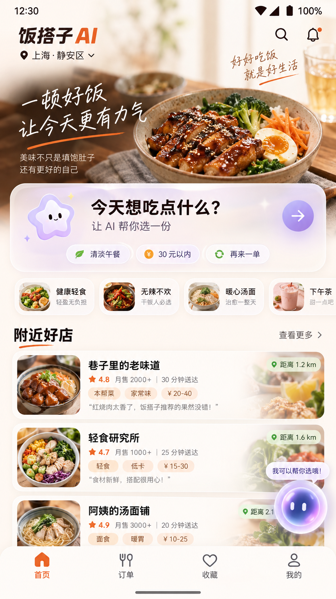
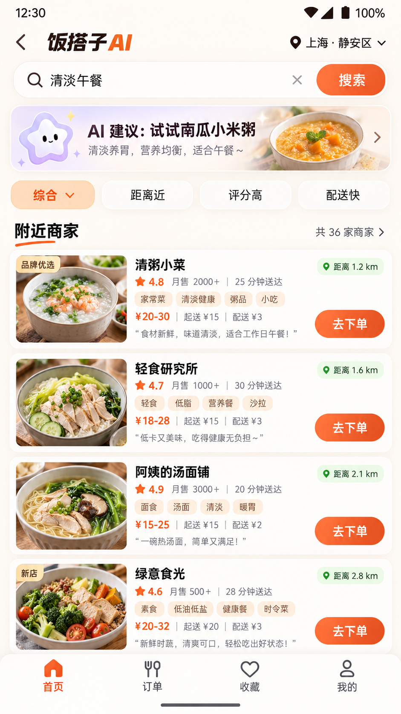
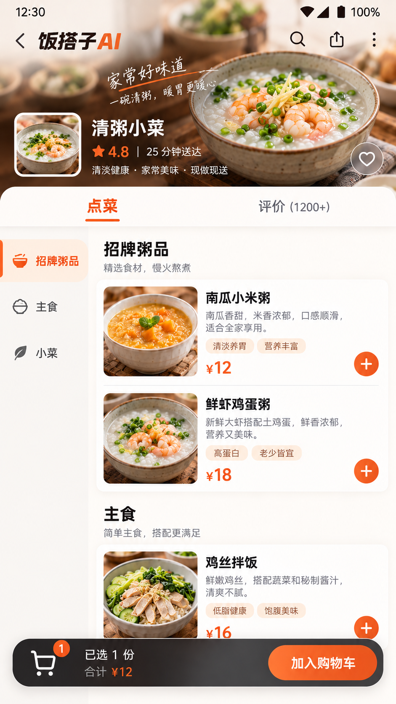
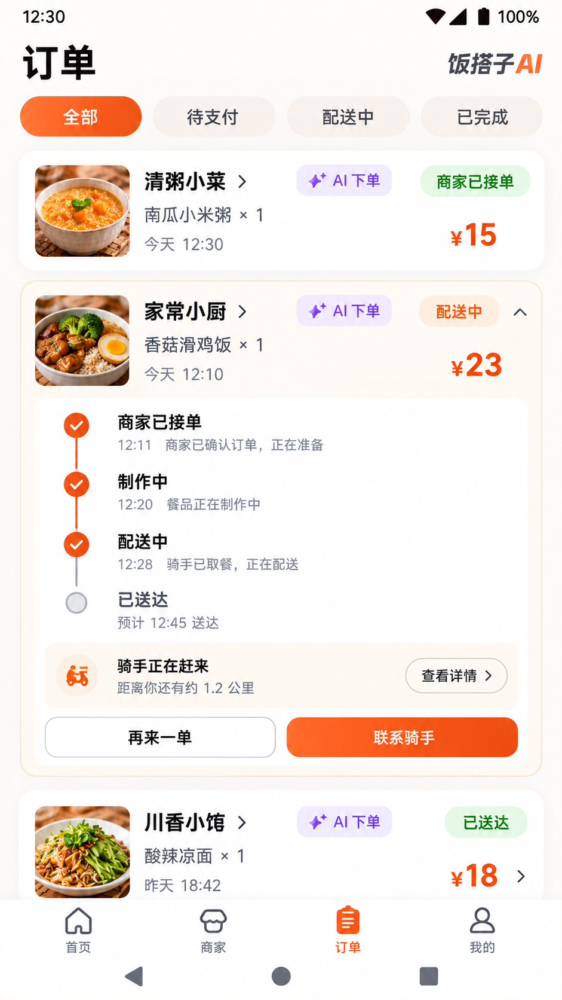
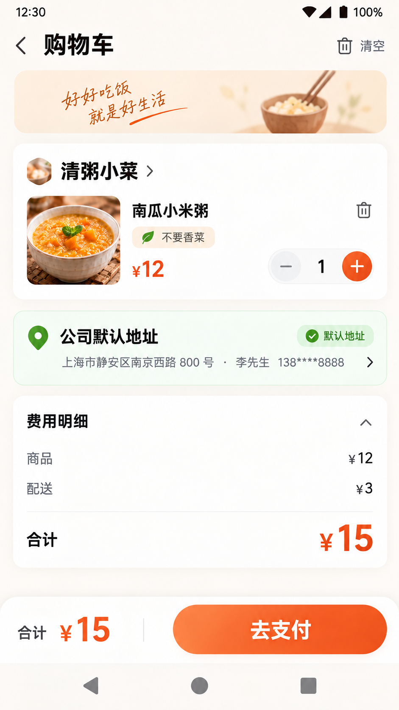
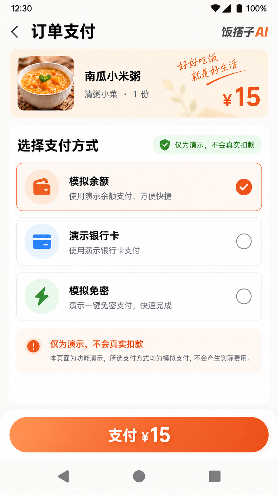
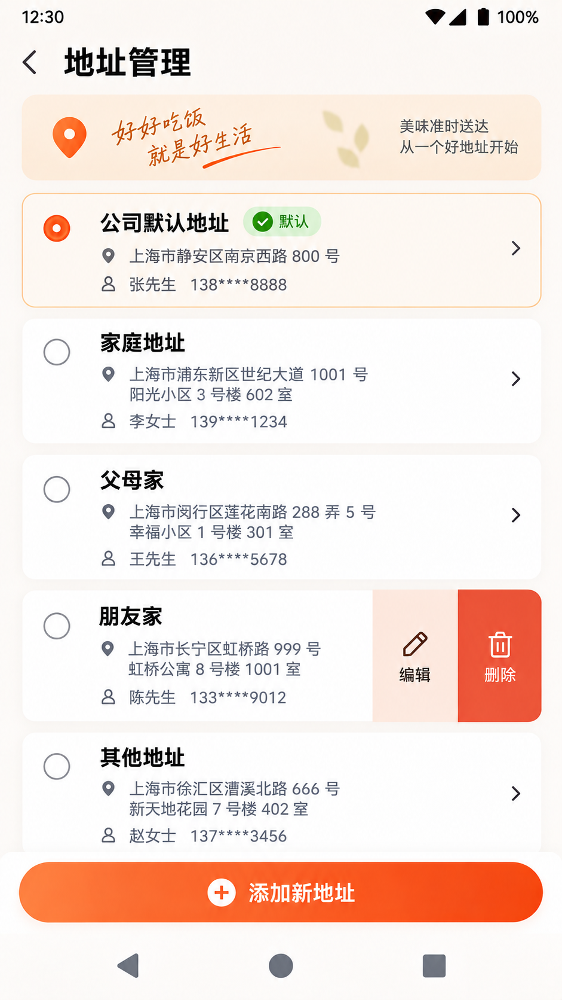
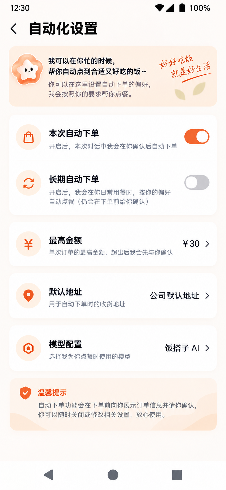

# 饭搭子 AI 现代化 UI 重构设计稿

> **当前唯一 UI 来源：** 本文档是饭搭子 AI 当前 Android UI、交互、页面状态、导航和 UI 验收标准的唯一来源。若其他设计文档与本文冲突，以本文为准。技术架构以 `docs/architecture.md` 为准，API、SSE 和 AI 授权协议以 `docs/api-and-agent.md` 为准。Android UI 必须直接依据本文和本文引用的设计稿实现；HTML 原型不属于视觉还原基准。

版本：v1.0  
目标平台：Android 手机端  
设计关键词：轻盈、温暖、可信、效率、AI 陪伴感

## 1. 重构目标

当前页面存在明显的“功能演示页”特征：内容集中在左上角，空白区域过大，操作入口缺少层级，按钮使用默认样式，AI 助手更像悬浮功能按钮而不是产品核心能力。

本次重构将首页改造成“外卖首页 + AI 点餐入口”的真实产品界面：

- 首屏 3 秒内让用户知道今天吃什么、如何搜索、如何让 AI 帮忙点餐。
- 将“搜索商家”“AI 帮我点”“最近订单”设为三类核心入口。
- 采用美团式高效率信息架构，但视觉上使用更克制、年轻的暖色体系，避免直接复制品牌。
- 保留 XML + MVVM、OkHttp、Glide 和现有业务闭环，不改变后端接口语义。
- 所有重要操作都提供清晰的状态反馈：加载、空状态、失败、确认、支付完成。

## 2. 视觉方向

### 2.1 色彩

| 用途 | 颜色 | 说明 |
| --- | --- | --- |
| 页面背景 | `#F7F8FA` | 淡灰白，降低大面积纯白的空洞感 |
| 卡片背景 | `#FFFFFF` | 主要内容容器 |
| 品牌橙 | `#FF6A2A` | 主按钮、价格、关键操作 |
| 品牌橙浅色 | `#FFF0E9` | 标签、选中背景、AI 建议卡片 |
| AI 紫 | `#635BFF` | AI 入口、AI 状态，不与下单主色混淆 |
| 主文字 | `#1F2329` | 标题和重要信息 |
| 次文字 | `#68707D` | 描述、配送时间、辅助说明 |
| 弱文字 | `#9AA1AB` | 占位符、时间、不可用内容 |
| 分割线 | `#EEF0F2` | 轻量分割，不使用深色边框 |
| 成功绿 | `#18A058` | 已支付、配送中、可用 |
| 警告红 | `#E5484D` | 下架、库存不足、支付失败 |

### 2.2 字体与尺寸

- 页面标题：24sp，Medium。
- 一级模块标题：18sp，Medium。
- 商品名称：15sp，Medium。
- 正文：14sp，Regular。
- 辅助文字：12sp，Regular。
- 主价格：22sp，Bold；小数和货币符号可使用 13sp。
- 页面左右边距：16dp。
- 卡片圆角：16dp；输入框和胶囊按钮：12dp 或 999dp。
- 内容区块间距：20dp；卡片内间距：12dp 或 16dp。
- 点击区域不小于 44dp。

### 2.3 图标和图片

- 使用统一线性图标，默认 20dp，重要入口 24dp。
- 商品图片使用 Glide 加载，比例 1:1，圆角 12dp。
- 图片失败时显示浅橙色占位图和餐具图标，不显示空白区域。
- 不使用大面积阴影；卡片只使用 `0 4dp 16dp rgba(31,35,41,0.06)` 的轻阴影。

## 3. 信息架构

底部导航统一为四项：

1. 首页：推荐、搜索、AI 点餐。
2. 商家：商家浏览和分类入口。
3. 订单：待支付、配送中、历史订单。
4. 我的：账号、地址管理、自动化策略、AI 助手说明、关于项目。

地址管理不作为底部 Tab，而是从下单确认、首页地址栏或“我的”进入；收藏作为商家/菜品的次级能力。已确认图片中个别底部导航文字存在生成稿差异，以上述统一信息架构为准。

AI 助手不作为第五个底部 Tab，而是作为全局浮动入口，避免破坏主导航结构。

### 3.1 页面与导航

| 入口/页面 | 主要职责 | 可进入页面 |
| --- | --- | --- |
| 登录/注册 | 登录、注册、跳过登录 | 首页 |
| 首页 Tab | 推荐、搜索、AI 点餐、附近好店 | 搜索、商家菜单、AI 面板、地址管理 |
| 商家 Tab | 商家分类和商家列表 | 商家菜单、规格选择、购物车 |
| 订单 Tab | 待支付、配送中、已完成和全部订单 | 订单详情、支付页 |
| 我的 Tab | 账号、地址、自动化策略、关于项目 | 地址管理、设置详情、通知 |
| 搜索页 | 关键词搜索、筛选和商家结果 | 商家菜单 |
| 商家菜单 | 菜品、规格和单商家购物车 | 规格弹层、结算页 |
| AI 面板 | 对话、执行进度、候选订单和确认 | 结算页/模拟支付页 |

访客可以浏览首页、商家、搜索和菜品；加购、地址管理、创建订单和自动化策略要求登录。登录成功后返回原操作并继续。四个 Tab 各自保留页面栈、滚动位置、筛选条件和输入内容；再次点击当前 Tab 时回到该 Tab 根页面。

### 3.2 统一页面状态

所有页面至少实现以下状态：

| 状态 | 含义 | 用户操作 |
| --- | --- | --- |
| `Initial` | 尚未发起加载或用户尚未输入 | 等待或开始操作 |
| `Loading` | 正在加载页面数据 | 等待；避免重复提交 |
| `Content` | 有可展示数据 | 正常操作 |
| `Empty` | 请求成功但没有数据 | 添加、搜索、重新开始或返回 |
| `Error` | 请求失败或数据不可用 | 查看原因、重试或返回 |
| `Submitting` | 正在提交写操作 | 暂时禁用重复操作 |
| `Disabled` | 当前条件不满足，不能操作 | 按提示补充条件 |
| `AwaitingConfirmation` | 等待用户明确确认 | 确认、修改或取消 |
| `Success` | 操作完成 | 查看结果或进入下一步 |

具体页面状态：

- 首页：`Initial → Loading → Content`；无有效地址时进入无地址状态，但搜索和 AI 推荐仍可用；加载失败进入可重试 `Error`。
- 搜索：`Idle → Searching → Results/Empty/NetworkError/AuthRequired`。
- 商家菜单：`Initial → Loading → Content/Empty/Error`；售罄菜品不可加购，规格不完整不可提交。
- 购物车与结算：`Content → Submitting → Content/ Error`；结算前重新校验价格、库存和地址。
- 地址：`Initial → Loading → Content/Empty/Error`；新增、编辑和删除使用 `Submitting`，失效地址进入 `Disabled`。
- 订单与支付：订单区分待支付、已支付、商家已接单、制作中、配送准备中、配送中、已送达、支付失败和已取消；支付失败可重新支付原订单。
- AI 助手：`Hidden → Half → Full → Recording → Recognizing → Sending → Executing → AwaitingConfirmation → CreatingOrder → OrderCreated/Error`。
- 自动化策略：`关闭 → 开启配置中 → 已开启`；缺少默认地址、超过金额上限、菜品变化或授权过期时进入 `被阻断`。

### 3.3 返回栈与页面转移

| 当前状态 | 返回或取消后的去向 |
| --- | --- |
| AI 全屏面板 | 收起为半屏 |
| AI 半屏面板 | 关闭面板，保留会话和候选订单 |
| 规格选择弹层 | 关闭弹层，保留已选项 |
| 商家菜单 | 返回搜索结果或进入前的商家列表 |
| 搜索结果 | 返回进入搜索前的页面 |
| 结算页 | 返回商家菜单/购物车，保留购物车和地址 |
| 模拟支付页取消或返回 | 回到结算页；订单保留为待支付 |
| 支付成功 | 进入订单详情和配送时间线 |
| 访客触发登录 | 登录成功后回到原操作并继续 |
| AI 候选订单点击“修改” | 回到 AI 面板，继续修改并重新校验 |

完整 AI 下单转移为：

```text
输入需求
→ 理解需求
→ 搜索商家/菜品
→ 构建候选订单
→ 等待确认
→ 创建待支付订单
→ 模拟支付
→ 查看配送状态
```

无地址时允许推荐和搜索；确认创建订单前必须选择有效地址；自动下单还必须存在有效默认地址和未超限的授权。

### 3.4 状态恢复策略

- 旋转屏幕时恢复全部页面状态。
- 进程被系统回收后恢复登录输入、搜索关键词、购物车、当前地址、AI 会话和待支付订单。
- 登录输入、搜索关键词和购物车属于临时状态，使用本地可恢复存储；订单和 AI 会话以后端为事实来源。
- 已支付订单重新从后端读取，不以本地缓存作为最终依据。
- AI 面板关闭或跨页面切换时保留会话、事件和候选订单；无法恢复时显示“会话已过期，可重新开始”。
- 恢复期间页面显示 `Loading` 或恢复态，禁止因短暂空值误显示 `Empty`。

### 3.5 购物车、地址与授权边界

- 首版购物车只允许单商家；切换商家加购时提示清空当前购物车或取消。
- 结算页选择地址只影响当前订单，不修改长期默认地址。
- 只有地址管理页明确执行“设为默认”时，才修改默认地址。
- 默认地址不能直接删除；必须先切换默认地址。
- 普通 AI 确认遵循“创建待支付订单 → 模拟支付”；本次自动和长期自动模式也不能绕过后端对地址、价格、库存、金额上限和授权有效期的校验。

## 4. 首页设计

### 4.0 已确认视觉稿




### 4.1 顶部区域

最终首页采用“首页 B”的视觉主体与“首页搜索入口 A”的搜索框交互。顶部包含饭搭子 AI 品牌、当前区域地址、搜索框和通知图标；首页主体使用大幅食物场景图和宣传文案，不使用“中午吃点什么？”作为顶部标题。

- 顶部地址显示为“上海 · 静安区”，点击进入地址管理。
- 搜索框前置到地址栏下方，点击后进入独立搜索页并自动聚焦输入框。
- 搜索入口 A 的搜索框文案为“搜索商家、菜品或直接说需求”，右侧为橙色语音按钮。
- 语音按钮进入录音态，录音结束后再进行识别。

### 4.2 AI 主入口

首页 B 和搜索入口 A 都在首屏放置 AI 点餐卡片，卡片实际文案为“今天想吃点什么？让 AI 帮你选一份”，右侧为紫色箭头入口。

- 卡片采用浅紫到暖橙的柔和渐变，并配有饭搭子 AI 星星形象。
- 快捷建议实际为“清淡午餐”“30 元以内”“再来一单”。
- 点击卡片或快捷建议打开 AI 底部面板并填入意图，不直接下单。

### 4.3 内容模块

首页实际视觉稿从上到下为：AI 点餐卡片、快捷偏好卡片、“附近好店”商家列表。

- 附近好店卡片展示商品图、商家名、评分、月售、配送时间、距离、标签和价格区间。
- “再来一单”作为 AI 快捷建议保留；历史订单不在当前首页首屏强制展示，统一从订单页进入。

### 4.4 首页状态

- 首次加载：骨架屏，不显示空白页面。
- 无地址：顶部显示“添加收货地址”，AI 自动点餐入口置灰并提示先配置地址。
- “再来一单”找不到可复购订单时，在 AI 面板中解释原因，并提供搜索或重新推荐入口。
- 网络失败：保留搜索框和 AI 入口，内容区显示“重新加载”。

## 5. 搜索页

### 5.0 已确认视觉稿



实际搜索页 A 为独立页面：顶部是返回按钮、饭搭子 AI 品牌和地址；下方是关键词输入框及橙色“搜索”按钮，随后是 AI 建议横幅、筛选胶囊和附近商家列表。

- 当前示例关键词为“清淡午餐”，输入框保留用户关键词。
- AI 建议横幅实际展示“AI 建议：试试南瓜小米粥”。
- 筛选项实际为“综合”“距离近”“评分高”“配送快”。
- 结果以商家卡片为主，展示图片、评分、月售、配送时间、标签、价格区间和“去下单”按钮。
- 后续可在商家菜单页内定位到具体菜品；搜索失败仍需区分网络错误、无结果和登录状态。

## 6. 商家与菜品页

### 6.0 已确认视觉稿




- 顶部为商家封面图、商家名、评分、配送信息。
- 菜品采用左图右文布局：图片 88dp，名称、描述、价格、加购按钮分层展示。
- 规格选择使用底部弹层，标题显示菜品名和当前价格。
- 规格项使用胶囊选择器；不可用规格显示删除线和“已售罄”。
- 底部固定购物车栏：商品数量、合计金额、“去结算”。
- 购物车栏不得遮挡最后一行菜品，列表底部预留 88dp。

## 7. AI 助手设计

### 7.0 已确认视觉稿


### 7.1 浮动入口

- 位置：右下角，避开底部导航 16dp。
- 尺寸：56dp，AI 紫色圆角方形，圆角 18dp。
- 图标：星光/饭碗组合，不使用信息“i”图标。
- 下方或旁边显示一次性提示气泡：“想吃什么，告诉我”。
- 页面滚动时浮球保持，打开键盘时自动上移。

### 7.2 底部 AI 面板

实际稿 A 是覆盖首页的底部抽屉：背景首页被压暗，面板顶部为拖拽条、饭搭子 AI 标题和关闭图标，底部保留输入栏。

- 对话气泡区分 AI 和用户，AI 使用浅紫背景，用户使用浅橙背景。
- 面板中实际展示“今天想吃什么？我可以帮你选一份”“我感冒了，中午清淡一点”等对话。
- 快捷建议实际为“清淡午餐”“30 元以内”“少油少辣”。
- 候选订单卡片实际展示商家、菜品图片、配送时间、标签、收货地址、合计 ¥28，以及“修改”“确认下单”。
- 输入栏使用麦克风按钮、文本输入框和橙色发送按钮，不使用旧线框中的“全屏”文字按钮。
- 录音状态显示波形、录音时长和“松开结束/点击结束”。
- 录音结束后显示“正在识别”，识别完成后把文本放回输入框，用户仍可编辑。
- AI 助手执行过程中展示用户可读进度：正在理解你的需求 → 正在寻找附近好店 → 正在查看菜品 → 正在准备订单。不向用户展示 Agent、模型、工具调用或工作流等技术概念。

### 7.3 确认订单卡片

AI 生成候选订单后，必须在对话中展示独立确认卡片：

- 商家名和商家头像。
- 菜品、规格、数量。
- 收货地址。
- 配送费、优惠、总金额。
- 下架/库存变化提示。
- 主按钮“确认下单”，次按钮“修改”。
- 自动化模式也必须有金额超限、地址缺失、菜品下架等阻断提示。

## 8. 订单页

### 8.0 已确认视觉稿







- 顶部使用状态 Tab：全部、待支付、配送中、已完成。
- 订单卡片包含商家、菜品摘要、总价、当前状态和操作按钮。
- 已确认订单稿 C 使用纵向进度时间线：商家已接单 → 制作中 → 配送中 → 已送达；实现以纵向样式为准。
- 模拟支付页使用真实支付页结构，但明确标注“模拟支付”。
- 支付成功后展示成功动画或成功图标，并提供“查看订单”。
- 失败订单显示失败原因和“重新尝试”，不显示无意义的异常堆栈。

## 9. 地址与设置页

### 9.0 已确认视觉稿





### 地址

- 地址稿 C 顶部使用地址主题横幅，下面是可单选的地址卡片；默认地址使用橙色选中态和绿色“默认”标签。
- 地址卡片展示地址名称、详细地址和联系人手机号；示例包含“公司默认地址”“家庭地址”“父母家”“朋友家”等。
- 支持新增、编辑、删除、设为默认。
- 左滑地址卡片可显示“编辑”和“删除”，底部固定橙色“添加新地址”按钮。
- 下单前如果没有有效默认地址，必须引导用户选择或新增。

### 设置

- “本次自动下单”：仅本次会话有效，默认关闭。
- “长期自动下单”：默认关闭，开启时必须配置最高金额和默认地址。
- 设置页不展示 Agent、模型、服务状态、API Base URL 或 API Key；用户只接触“AI 助手”这一产品概念。
- 重要设置使用说明文字解释，不使用开发者术语。

## 10. 登录与注册

### 10.0 已确认视觉稿


登录与注册页采用 B 版的极简 AI 风格：顶部为“饭搭子 AI”品牌、暖色手写标语和星星形象，中部为“今天吃什么，让我来帮你”的 AI 引导卡片，下方为白色登录表单卡片。

- 登录和注册通过顶部 Tab 切换，默认选中“登录”。
- 登录字段为“用户名”和“密码”，输入框下方显示对应校验错误。
- 主按钮为橙色实心“登录”；同时提供“注册新账号”和“跳过登录”入口。
- 页面提示“登录后即可保存地址和点餐偏好”，与真实用户体系保持一致。
- 登录成功后进入首页，不再展示“你好，demo”作为主视觉；注册成功后自动登录。

## 11. 动效与反馈

- 页面切换：150–220ms 淡入 + 轻微位移。
- AI 面板：底部上滑，280ms，使用标准减速曲线。
- 加购：购物车数量徽标缩放一次。
- 下单：确认按钮点击后进入 loading，防止重复提交。
- 网络请求超过 500ms 显示骨架或 loading，避免界面静止。
- 所有 Toast 优先替换为 Snackbar 或页面内状态提示。

## 12. 本次 Android 重构优先级

### P0：必须先做

- 首页整体布局和视觉 token。
- 底部导航。
- 搜索框、AI 卡片和“再来一单”快捷建议。
- AI 浮球和底部助手面板。
- 订单确认卡片。
- 登录页和首页空状态/加载状态。

### P1：随后完善

- 商家列表、商家菜单、规格弹层。
- 购物车底栏和结算页。
- 订单列表、订单时间线、模拟支付页。
- 地址列表和自动化设置页。

### P2：最后打磨

- 动效、图片占位、错误状态。
- 深色模式适配。
- 无障碍 contentDescription 和字号放大适配。
- 横屏和小屏幕适配。

## 13. 验收标准

- 首屏不再出现大面积空白区域。
- 首页能看到搜索、AI 点餐和“再来一单”三个核心入口。
- 所有主按钮使用统一的圆角、颜色、字号和点击反馈。
- AI 面板打开后可完成录音/文字输入、解析进度、候选订单确认。
- 订单确认卡片清晰展示菜品、规格、地址、金额。
- 登录、搜索、加购、结算、模拟支付、订单追踪的业务接口不被 UI 重构破坏。
- 在 360dp、393dp、412dp 宽度模拟器上不出现文字截断、按钮遮挡或底部栏覆盖。
- 使用真实后端和测试账号完成：登录 → 搜索 → 加购 → 确认 → 模拟支付 → 查看配送状态。

## 14. 重构后的首页一句话描述

“打开饭搭子 AI，先看到今天怎么吃；想自己选就搜索，懒得选就把需求交给 AI。”

## 15. 已确认设计稿

以下设计稿是当前已确认的视觉基线，后续 Android 重构以它们为准。每次确认新页面或组件后，都必须在本节追加记录。

| 页面/组件 | 已选版本 | 项目内参考图 | 采用要点 |
| --- | --- | --- | --- |
| 首页 | B | `docs/ui-design-references/home-b.png` | 高级生活方式首页、大图食物场景、暖米色背景、AI 卡片突出 |
| 首页搜索入口 | A | `docs/ui-design-references/home-search-entry-a.png` | 地址栏下方独立搜索框，带语音入口，首屏可见且不破坏首页大图 |
| AI 助手底部面板 | A | `docs/ui-design-references/ai-panel-a.png` | 对话气泡、推荐订单卡片、地址/金额确认、修改与确认下单 |
| 搜索页 | A | `docs/ui-design-references/search-a.png` | 传统高效率商家列表、AI 建议横幅、评分/配送/价格信息 |
| 商家菜单页 | A | `docs/ui-design-references/merchant-menu-a.png` | 左侧分类、右侧菜品列表、图片/描述/价格、底部购物车 |
| 菜品规格选择弹层 | A | `docs/ui-design-references/dish-options-a.png` | 大图沉浸、忌口选择、数量控制、底部加入购物车 |
| 购物车与结算页 | C | `docs/ui-design-references/checkout-c.png` | 快捷购物车、默认地址、费用明细、去支付 |
| 模拟支付页 | C | `docs/ui-design-references/mock-payment-c.png` | 多种模拟支付方式、醒目演示提示、支付金额固定展示 |
| 订单列表与配送时间线 | C | `docs/ui-design-references/orders-timeline-c.png` | 可展开订单卡片、纵向状态时间线、AI 下单标签、联系骑手 |
| 地址管理页 | C | `docs/ui-design-references/address-management-c.png` | 单选切换默认地址、地址信息卡片、编辑删除、添加新地址 |
| 设置与自动化策略页 | A | `docs/ui-design-references/automation-settings-a.png` | AI 说明卡、本次/长期自动下单开关、最高金额、默认地址、安全提示；不暴露 Agent 或模型配置 |
| 登录与注册页 | B | `docs/ui-design-references/auth-b.png` | 极简 AI 品牌区、AI 引导卡、登录/注册 Tab、用户名密码表单、跳过登录入口 |

### 15.0 设计稿图片预览

> 以下图片使用相对路径嵌入，直接打开本 Markdown 文件即可预览；图片原文件保存在 `docs/ui-design-references/`。

#### 首页 · B


#### 首页搜索入口 · A


#### AI 助手底部面板 · A


#### 搜索页 · A


#### 商家菜单页 · A


#### 菜品规格选择弹层 · A


#### 购物车与结算页 · C


#### 模拟支付页 · C


#### 订单列表与配送时间线 · C


#### 地址管理页 · C


#### 设置与自动化策略页 · A


### 15.1 当前页面关系

首页与搜索页是两个独立页面：首页负责推荐和入口，搜索页负责结果浏览。

- 首页搜索框 → 搜索页。
- 首页 AI 卡片 → AI 助手底部面板。
- 首页“附近好店” → 商家列表。
- 搜索页商家卡片 → 商家菜单页。
- AI 面板中的候选订单卡片 → 订单确认流程。

### 15.2 待确认页面

暂无。
