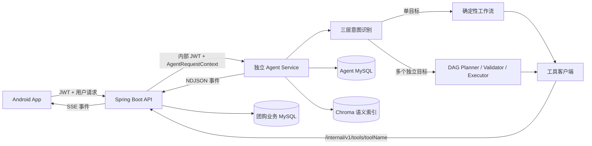

# 团购重构历史快照（2026-10-01 文档重构前）

本文保留原计划和规格原文，用于追溯历史执行记录、勾选及失败证据，不是当前实施依据。旧记录中的通过、待确认、代理正在验收等状态仅代表当时记录；当前状态见重构后的计划。用户已暂缓核销、人工确认 Task8 设计并允许轻微 UI 尺寸和颜色差异。

## 原实施计划

# 饭搭子 AI 团购化与独立 Agent 服务重构 Implementation Plan

> **For agentic workers:** REQUIRED SUB-SKILL: Use superpowers:subagent-driven-development (recommended) or superpowers:executing-plans to implement this plan task-by-task. Steps use checkbox (`- [ ]`) syntax for tracking.

**Goal:** 将现有外卖 App 重构为可运行的餐饮到店团购 App，并用 `D:\project\-Demo-master` 独立 Agent 服务替换手机项目旧 Agent Service。

**Architecture:** 先冻结跨仓库契约、团购核心模型和安全边界，再按浏览推荐、购买支付、券核销、售后支持、长期记忆五个纵向切片完成 Spring Boot、Agent 和 Android。Android 只连接 Spring Boot，Agent 只通过 Spring 白名单工具访问业务事实。Android 禁止写死门店、套餐、菜品、评价、订单、优惠券、价格、库存、状态和用户账户等业务数据；除底部 Tab 等纯 UI 结构外，页面展示和交互必须使用 Spring Boot 后端接口，接口失败不得回退到静态业务数据。

**Tech Stack:** Android XML + MVVM + OkHttp + Gson、Spring Boot 3.4.5 + Java 17 + JPA + Flyway + MySQL、Python + LangGraph + FastAPI + MySQL + Chroma、JUnit + pytest + Robolectric + MockWebServer + Maestro。

**Spec:** `docs/superpowers/specs/2026-09-29-group-buying-agent-refactor-design.md`

**UI Spec:** `D:\project\-Demo-master\docs\ui-design\ui-design-spec.md`

**Figma:** `https://www.figma.com/design/FxsWKGs10z7BL1MhFAOqFN`

## Global Constraints

- 手机项目根目录：`C:\Users\caid0\Documents\ChatGPT\手机agent\.worktrees\fandazi-ai`。
- Agent 项目根目录：`D:\project\-Demo-master`。
- 所有新增或修改的代码、测试和配置注释必须使用详细、准确的中文。
- 不修改 Agent 基线文件 `node/base_node/decisionNode.py`、`node/base_node/routerNode.py` 和历史实验脚本，除非后续任务明确授权。
- 不修改手机项目已执行的 Flyway `V1-V5`，新迁移从 `V6` 开始。
- Android 不直连 Agent；Agent 不直连手机业务数据库。
- 业务金额协议统一使用整数分，时间统一使用 UTC ISO-8601，外部资源使用 UUID `publicId`。
- 购买、模拟支付、退款和投诉必须经过 Spring Boot 一次性确认凭证。
- Agent 只在聊天框输出文字或结构化卡片，不自动跳转页面。
- Android UI 必须先完成对应 Figma Frame 的逐页确认，再转换为 XML；UI 视觉开发不采用 TDD，业务状态和 ViewModel 逻辑仍需自动化测试。
- 底部导航固定为`首页`、`AI助手`、`订单`、`我的`，并使用房屋、机器人、订单单据、用户轮廓图标；禁止字符、圆点、圆形底板或第五个 Tab。
- `UI-15A`至`UI-15J`是十个独立 Figma Frame，但 Android 只实现一个`AgentChatFragment`和一个导航目的地。
- 每完成一个任务，运行该任务列出的测试并勾选复选框；不得用预期结果代替实测结果。
- 所有 Agent 实验同步记录到 `D:\project\-Demo-master\docs\experiments\intent-routing-experiments.md`。
- 工作树当前包含既有未提交修改；执行者不得覆盖、回退或混入无关文件。

## Repository Map

### 手机项目

- `contracts/`：跨仓库协议唯一来源。
- `backend/src/main/java/com/fandazi/feature/`：团购领域、Agent Gateway 和工具执行。
- `backend/src/main/resources/db/migration/`：仅追加 Flyway 迁移。
- `android-app/app/src/main/`：Android 页面、网络模型和聊天卡片。
- `data/seed/`：确定性团购种子数据。
- `maestro/`：每个 Android 切片的真实模拟器验收。
- `D:\project\-Demo-master\docs\ui-design\ui-design-spec.md`：跨仓库 UI 字段、页面状态和禁止项的规格来源。

### Agent 项目

- `service/`：FastAPI 内部服务、鉴权、NDJSON 和协议模型。
- `intent/`、`config/intent_templates.yaml`、`config/local_exact_intents.yaml`：团购意图体系。
- `dag/`：工作流、DAG、工具契约和执行器。
- `memory/`：Agent 长期记忆主存储与语义索引。
- `persistence/`、`database/schema/`：Agent 审计、运行和记忆持久化。
- `tests/`：契约、工具、记忆、场景与评测测试。

---

### Task 1: 冻结跨仓库协议与契约校验

**Files:**
- Create: `[手机] contracts/agent-protocol-v1.yaml`
- Create: `[手机] contracts/agent-tools-v1.yaml`
- Create: `[手机] backend/src/test/java/com/fandazi/feature/agent/AgentContractSchemaTest.java`
- Create: `[Agent] config/contracts/agent-protocol-v1.yaml`
- Create: `[Agent] config/contracts/agent-tools-v1.yaml`
- Create: `[Agent] config/contracts/source.sha256`
- Create: `[Agent] tests/test_cross_repo_contracts.py`

**Interfaces:**
- Produces: `AgentRunRequestV1`、`AgentEventV1`、`AgentRunResultV1`、`AgentCardV1`、`ToolRequestV1`、`ToolResultV1`。
- Produces: 15 个工具的参数、返回值、风险等级、确认要求和错误码。
- Consumes: 规格第 7、8、11、12 节。

- [x] **Step 1: 编写失败的 Java 契约测试**

```java
@Test
void agentToolContractContainsEveryApprovedTool() {
    Set<String> expected = Set.of(
        "search_stores", "get_store_detail", "list_deal_packages",
        "get_deal_detail", "search_reviews", "list_user_orders",
        "get_order_detail", "list_user_vouchers", "create_purchase_quote",
        "create_group_buy_order", "pay_mock_order", "request_refund",
        "query_coupon", "query_faq", "submit_complaint"
    );
    assertThat(loadContractToolNames()).containsExactlyInAnyOrderElementsOf(expected);
}
```

- [x] **Step 2: 运行测试并确认因契约不存在而失败**

Run: `mvn -f backend/pom.xml -Dtest=AgentContractSchemaTest test`

Expected: FAIL，错误明确指出 `contracts/agent-tools-v1.yaml` 不存在。

- [x] **Step 3: 编写两份权威 YAML 契约**

```yaml
schemaVersion: "1.0"
toolRequest:
  required: [schemaVersion, userId, sessionId, traceId, runId, taskId, idempotencyKey, payload]
toolResult:
  required: [schemaVersion, ok, data, error]
errors:
  - VALIDATION_ERROR
  - NOT_FOUND
  - FORBIDDEN
  - CONFLICT
  - EXPIRED
  - RATE_LIMITED
  - DEPENDENCY_UNAVAILABLE
  - INTERNAL_ERROR
```

- [x] **Step 4: 在 Agent 仓库写入受控副本和摘要校验测试**

```python
def test_contract_copy_matches_declared_sha256():
    expected = Path("config/contracts/source.sha256").read_text(encoding="utf-8").strip()
    actual = hashlib.sha256(Path("config/contracts/agent-tools-v1.yaml").read_bytes()).hexdigest()
    assert actual == expected
```

- [x] **Step 5: 运行双端契约测试**

Run: `mvn -f backend/pom.xml -Dtest=AgentContractSchemaTest test`

Run: `C:\Users\caid0\anaconda3\envs\pinnT\python.exe -m pytest tests/test_cross_repo_contracts.py -q`

Expected: 两端全部 PASS，工具名、版本和摘要一致。

- [x] **Step 6: 提交契约地基**

```bash
# 手机项目提交
git add contracts backend/src/test/java/com/fandazi/feature/agent/AgentContractSchemaTest.java
git commit -m "feat: define group buying agent contracts"

# Agent 项目提交
git add config/contracts tests/test_cross_repo_contracts.py
git commit -m "feat: import versioned mobile agent contracts"
```

### Task 2: 建立团购数据库、领域实体和确定性种子数据

**Files:**
- Create: `[手机] backend/src/main/resources/db/migration/V6__create_group_buying_domain.sql`
- Create: `[手机] backend/src/main/resources/db/migration/V7__migrate_merchants_to_stores.sql`
- Create: `[手机] backend/src/main/java/com/fandazi/feature/catalog/StoreEntity.java`
- Create: `[手机] backend/src/main/java/com/fandazi/feature/catalog/DealPackageEntity.java`
- Create: `[手机] backend/src/main/java/com/fandazi/feature/purchase/PurchaseQuote.java`
- Create: `[手机] backend/src/main/java/com/fandazi/feature/grouporder/GroupBuyOrderEntity.java`
- Create: `[手机] backend/src/main/java/com/fandazi/feature/voucher/VoucherEntity.java`
- Create: `[手机] backend/src/main/java/com/fandazi/feature/refund/RefundRequestEntity.java`
- Create: `[手机] backend/src/main/java/com/fandazi/feature/coupon/CouponEntity.java`
- Create: `[手机] backend/src/main/java/com/fandazi/feature/coupon/UserCouponEntity.java`
- Create: `[手机] backend/src/main/java/com/fandazi/feature/support/ComplaintTicketEntity.java`
- Create: `[手机] backend/src/main/java/com/fandazi/feature/agent/ConfirmationGrantEntity.java`
- Create: `[手机] backend/src/main/java/com/fandazi/feature/agent/AgentMessageEntity.java`
- Modify: `[手机] backend/src/main/java/com/fandazi/feature/catalog/MerchantEntity.java`
- Modify: `[手机] backend/src/main/java/com/fandazi/seed/SeedDataLoader.java`
- Create: `[手机] data/seed/stores.json`
- Create: `[手机] data/seed/deals.json`
- Create: `[手机] data/seed/group-orders.json`
- Create: `[手机] data/seed/vouchers.json`
- Create: `[手机] data/seed/coupons.json`
- Modify: `[手机] data/seed/reviews.json`
- Test: `[手机] backend/src/test/java/com/fandazi/feature/groupbuy/GroupBuyingSchemaTest.java`
- Test: `[手机] backend/src/test/java/com/fandazi/seed/GroupBuyingSeedDataTest.java`

**Interfaces:**
- Produces: `Merchant.publicId`、`Store.publicId`、`DealPackage.publicId`、`GroupBuyOrder.publicId`、`Voucher.publicId`。
- Produces: `OrderStatus` 和 `VoucherStatus` 的规格状态机。
- Consumes: Task 1 金额、时间和公开 ID 规则。

- [x] **Step 1: 编写失败的 Flyway 和状态机测试**

```java
@Test
void onePurchasedQuantityCreatesOneVoucher() {
    GroupBuyOrderEntity order = fixture.paidOrderWithQuantity(3);
    assertThat(order.getVouchers()).hasSize(3);
    assertThat(order.getVouchers()).allMatch(v -> v.getStatus() == VoucherStatus.UNUSED);
}
```

- [x] **Step 2: 运行新测试确认缺少团购实体**

Run: `mvn -f backend/pom.xml -Dtest=GroupBuyingSchemaTest,GroupBuyingSeedDataTest test`

Expected: FAIL，缺少团购表或类型。

- [x] **Step 3: 添加 V6/V7 迁移和实体映射**

迁移必须创建品牌公开 ID、门店、套餐适用门店、报价、团购订单、券、退款和确认凭证，并为幂等键、公开 ID、用户订单和券状态建立唯一约束或索引。

- [x] **Step 4: 生成确定性种子数据**

数据量固定为至少 20 个品牌、30 家门店、120 个套餐、300 条评价和 30 张优惠券定义；订单与券覆盖全部规格状态。种子图片使用已有本地授权素材或项目占位图。

- [x] **Step 5: 运行领域和种子测试**

Run: `mvn -f backend/pom.xml -Dtest=GroupBuyingSchemaTest,GroupBuyingSeedDataTest test`

Expected: PASS，重复执行 seed 不产生重复数据。

- [x] **Step 6: 提交领域地基**

```bash
git add backend/src/main/resources/db/migration backend/src/main/java/com/fandazi/feature data/seed backend/src/test/java/com/fandazi
git commit -m "feat: add group buying domain foundation"
```

### Task 3: 为新 Agent 建立 FastAPI、内部 JWT 和 NDJSON 运行协议

**Files:**
- Create: `[Agent] service/__init__.py`
- Create: `[Agent] service/app.py`
- Create: `[Agent] service/models.py`
- Create: `[Agent] service/auth.py`
- Create: `[Agent] service/streaming.py`
- Modify: `[Agent] requirements.txt`
- Create: `[Agent] tests/test_agent_service_api.py`
- Modify: `[手机] backend/src/main/java/com/fandazi/feature/agent/AgentRunRequest.java`
- Modify: `[手机] backend/src/main/java/com/fandazi/feature/agent/AgentResult.java`
- Modify: `[手机] backend/src/main/java/com/fandazi/feature/agent/HttpAgentServiceClient.java`
- Modify: `[手机] backend/src/main/java/com/fandazi/feature/agent/AgentGatewayService.java`
- Create: `[手机] backend/src/main/java/com/fandazi/feature/agent/AgentMessageRepository.java`
- Create: `[手机] backend/src/main/java/com/fandazi/feature/agent/AgentMessageService.java`
- Test: `[手机] backend/src/test/java/com/fandazi/feature/agent/AgentGatewayV1ContractTest.java`

**Interfaces:**
- Produces: `POST /internal/v1/agent/runs`，响应 `application/x-ndjson`。
- Produces: `GET /internal/v1/health`。
- Consumes: `AgentRunRequestV1`、`AgentEventV1`、短期内部 JWT。

- [x] **Step 1: 编写失败的 Agent API 测试**

```python
def test_run_rejects_missing_internal_jwt(client):
    response = client.post("/internal/v1/agent/runs", json=valid_request())
    assert response.status_code == 401

def test_run_streams_started_and_completed_events(client, internal_jwt):
    response = client.post(
        "/internal/v1/agent/runs",
        headers={"Authorization": f"Bearer {internal_jwt}"},
        json=valid_request(text="你好"),
    )
    events = [json.loads(line) for line in response.text.splitlines()]
    assert events[0]["type"] == "run_started"
    assert events[-1]["type"] == "run_completed"
```

- [x] **Step 2: 运行测试并确认 HTTP 服务不存在**

Run: `C:\Users\caid0\anaconda3\envs\pinnT\python.exe -m pytest tests/test_agent_service_api.py -q`

- [x] **Step 3: 实现 FastAPI、Pydantic 模型、JWT 校验和 NDJSON 编码**

`runId` 由 Agent 创建；`traceId` 由 Spring 传入；简单请求不生成 `planId`。流式事件只允许公开业务摘要。

- [x] **Step 4: 修改 Spring 客户端逐行消费 NDJSON**

Spring 每收到一条事件就调用 `AgentEventService.record(...)`，终态映射为 `AgentRunResultV1`，传输中断映射为 `DEPENDENCY_UNAVAILABLE`。

- [x] **Step 5: 运行 Python 和 Java 协议测试**

Run: `C:\Users\caid0\anaconda3\envs\pinnT\python.exe -m pytest tests/test_agent_service_api.py -q`

Run: `mvn -f backend/pom.xml -Dtest=AgentGatewayV1ContractTest test`

Expected: JWT 拒绝、NDJSON 顺序、终态解析和中断处理全部 PASS。

- [x] **Step 6: 提交运行协议**

```bash
git add service requirements.txt tests/test_agent_service_api.py
git commit -m "feat: expose versioned agent run stream"

git add backend/src/main/java/com/fandazi/feature/agent backend/src/test/java/com/fandazi/feature/agent/AgentGatewayV1ContractTest.java
git commit -m "feat: consume independent agent event stream"
```

### Task 4: 完成浏览、排序和套餐推荐纵向切片

**Files:**
- Create: `[手机] backend/src/main/java/com/fandazi/feature/catalog/StoreController.java`
- Create: `[手机] backend/src/main/java/com/fandazi/feature/catalog/StoreService.java`
- Create: `[手机] backend/src/main/java/com/fandazi/feature/catalog/DealPackageController.java`
- Create: `[手机] backend/src/main/java/com/fandazi/feature/catalog/DealPackageService.java`
- Refactor: `[手机] backend/src/main/java/com/fandazi/feature/agent/AgentToolService.java`
- Modify: `[Agent] dag/tool_registry.py`
- Modify: `[Agent] dag/tool_adapters.py`
- Modify: `[Agent] config/intent_templates.yaml`
- Modify: `[Agent] intent/models.py`
- Create: `[Agent] workflows/recommendation.py`
- Create: `[Agent] workflows/__init__.py`
- Modify: `[手机] android-app/app/src/main/java/com/fandazi/app/feature/home/HomeFragment.kt`
- Modify: `[手机] android-app/app/src/main/java/com/fandazi/app/feature/home/HomePresentationState.kt`
- Create: `[手机] android-app/app/src/main/java/com/fandazi/app/feature/home/SearchResultsFragment.kt`
- Create: `[手机] android-app/app/src/main/java/com/fandazi/app/feature/home/SearchFilterState.kt`
- Create: `[手机] android-app/app/src/main/java/com/fandazi/app/feature/store/StoreFragment.kt`
- Create: `[手机] android-app/app/src/main/java/com/fandazi/app/feature/store/StoreModels.kt`
- Create: `[手机] android-app/app/src/main/java/com/fandazi/app/feature/store/StoreDealsFragment.kt`
- Create: `[手机] android-app/app/src/main/java/com/fandazi/app/feature/store/StoreDishesFragment.kt`
- Create: `[手机] android-app/app/src/main/java/com/fandazi/app/feature/store/StoreReviewsFragment.kt`
- Create: `[手机] android-app/app/src/main/java/com/fandazi/app/feature/deal/DealDetailFragment.kt`
- Create: `[手机] android-app/app/src/main/res/layout/fragment_home.xml`
- Create: `[手机] android-app/app/src/main/res/layout/fragment_search_results.xml`
- Create: `[手机] android-app/app/src/main/res/layout/fragment_store.xml`
- Create: `[手机] android-app/app/src/main/res/layout/fragment_store_deals.xml`
- Create: `[手机] android-app/app/src/main/res/layout/fragment_store_dishes.xml`
- Create: `[手机] android-app/app/src/main/res/layout/fragment_store_reviews.xml`
- Create: `[手机] android-app/app/src/main/res/layout/fragment_deal_detail.xml`
- Modify: `[手机] android-app/app/src/main/res/navigation/nav_graph.xml`
- Test: `[手机] backend/src/test/java/com/fandazi/feature/catalog/StoreDealApiTest.java`
- Test: `[Agent] tests/test_group_buying_read_tools.py`
- Test: `[手机] android-app/app/src/test/java/com/fandazi/app/feature/home/HomeSortTest.kt`
- Create: `[手机] maestro/group-buying-01-browse.yaml`
- Design: `UI-01`至`UI-06`，用于首页、搜索筛选、门店三 Tab 和套餐详情的 XML 转换基准。

**Interfaces:**
- Produces: `GET /api/stores`，参数 `cityCode/sort/latitude/longitude/category/minPrice/maxPrice`。
- Produces: `GET /api/stores/{publicId}`、`GET /api/stores/{publicId}/deals`、`GET /api/deals/{publicId}`。
- Produces tools: `search_stores`、`get_store_detail`、`list_deal_packages`、`get_deal_detail`、`search_reviews`。
- Produces intents: `greeting`、`chitchat`、`store_recommendation`、`deal_recommendation`、`store_info`、`review_query`、`group_buy_order`、`coupon`、`refund_after_sale`、`complaint`、`faq`、`out_of_scope` 的基础定义。

- [x] **Step 1: 编写失败的排序和工具测试**

```java
@Test
void distanceSortRequiresUsableLocation() {
    mockMvc.perform(get("/api/stores").param("sort", "DISTANCE"))
        .andExpect(status().isBadRequest())
        .andExpect(jsonPath("$.code").value("VALIDATION_ERROR"));
}
```

```python
def test_single_recommendation_goal_uses_deterministic_workflow():
    result = run_workflow("推荐附近人均100以内的川菜团购")
    assert result.is_composite is False
    assert result.tool_names == ["search_stores", "list_deal_packages"]
```

- [x] **Step 2: 运行三端测试并确认失败**

Run: `mvn -f backend/pom.xml -Dtest=StoreDealApiTest test`

Run: `C:\Users\caid0\anaconda3\envs\pinnT\python.exe -m pytest tests/test_group_buying_read_tools.py -q`

Run: `cd android-app; .\gradlew.bat testDebugUnitTest --tests "*HomeSortTest"`

- [x] **Step 3: 实现 Spring 查询、排序和工具分派**

综合排序必须稳定；人均使用 `Store.averageSpendCents`；距离排序只在有效坐标存在时启用。工具结果只返回契约允许字段。

- [x] **Step 4: 迁移 12 类意图基础定义并实现 Agent 确定性推荐工作流**

先一次性迁移 12 类意图名称、输出模型和最小可用边界示例，确保后续购买、券和售后切片不再依赖旧外卖意图；千级本地文案和完整离线评测留到 Task 9。随后实现推荐确定性工作流。一个推荐目标可以串行调用多个只读工具，但保持 `is_composite=false`；多个独立目标才进入 DAG。

- [x] **Step 5: 先完成 Figma UI 设计，再改造 Android 首页、门店和套餐页面**

UI 实施不采用 TDD。必须先在最新 Figma 中逐页确认以下 Frame，再将设计转换为 Android XML：

1. `UI-01 首页`：位置、搜索、横向分类、`人均/距离/筛选`和门店卡片，不显示 AI 横幅。
2. `UI-02 搜索与筛选结果`：保持`首页`Tab选中，复用分类、排序与筛选状态。
3. `UI-03 门店详情`：第一行只保留`优惠/菜品/评价`，默认展示优惠套餐。
4. `UI-04 门店菜品`：展示菜品列表，不提供外卖加购。
5. `UI-05 门店评价`：展示评分分布与评价列表。
6. `UI-06 套餐详情`：展示套餐明细、使用规则和固定购买操作，移除右上角搜索、收藏、分享和更多按钮。

Figma 设计文件：`https://www.figma.com/design/FxsWKGs10z7BL1MhFAOqFN`。

完成 Figma 逐页确认后，按设计稿转换 XML，并保证首页不显示商圈；定位拒绝时禁用距离排序；门店页不出现`买单/环境服务/更多`、菜品加购和旧外卖购物车。`UI-01`至`UI-06`底部导航使用四个具体图标，不残留旧`Tab Icon/...`椭圆节点。实际完成的 Figma Frame 为 `UI-01`（`63:2`）、`UI-02`（`63:88`）、`UI-03`（`64:2`）、`UI-04`（`64:88`）、`UI-05`（`64:144`）和`UI-06`（`64:225`）；Android 端使用现有单一导航容器实现门店三 Tab，行为与页面设计一致。

- [x] **Step 6: 运行 Android 构建、Maestro 和视觉验收**

UI 验收顺序固定为：

1. 构建最新 debug APK。
2. 从模拟器卸载旧版 `com.fandazi.app` 和干扰应用 `com.dirror.music`。
3. 安装最新 APK。
4. 执行 `maestro test maestro/group-buying-01-browse.yaml`。
5. 对照 Figma 设计稿检查页面层级、间距、颜色、字体、文字溢出和点击路径。

Run: `mvn -f backend/pom.xml -Dtest=StoreDealApiTest test`

Run: `C:\Users\caid0\anaconda3\envs\pinnT\python.exe -m pytest tests/test_group_buying_read_tools.py -q`

Run: `cd android-app; .\gradlew.bat testDebugUnitTest assembleDebug`

Run: `maestro test maestro/group-buying-01-browse.yaml`

Expected: `UI-01`至`UI-06`与 XML 页面一致；登录和游客都能浏览；分类、三种排序和筛选符合规则；门店三 Tab 正确；推荐工具序列正确；底部导航无圆形占位；Maestro 真实模拟器流程通过。

实际验证结果：`assembleDebug` 构建通过；后端 `StoreDealApiTest` 为 2/2 通过；Agent `test_group_buying_read_tools.py` 为 2/2 通过；Maestro `group-buying-01-browse.yaml` 在 `Medium_Phone_API_36.1` 上完整通过，覆盖游客浏览、搜索、门店三 Tab 和套餐详情。截图复核确认底部导航为四个具体图标且无默认选中胶囊。Android 全量 `testDebugUnitTest` 可执行，但现有 122 个测试中有 6 个与本次切片无关的既有失败（`AgentViewModelTest` 2 个、`MerchantFeedViewModelTest` 1 个、`MerchantNavigationPagesTest` 3 个）；本切片相关的 `HomeSortTest` 单独运行通过。Windows 含中文工作树路径会使 Gradle 测试类加载失败，使用临时盘符映射后已完成真实测试执行。

- [x] **Step 7: 视觉验收通过后提交浏览推荐切片**

```bash
git add backend android-app maestro
git commit -m "feat: add group buying discovery slice"

git add dag workflows tests/test_group_buying_read_tools.py
git commit -m "feat: orchestrate store and deal recommendations"
```

本次已提交浏览推荐 UI 切片：`a616c99 feat: add group buying discovery UI slice`。Agent 工作流与后端查询代码沿用此前已完成的提交，未在本次 UI 提交中重复改写。

### Task 5 历史基线：建立 Android AI 标签、流式消息和聊天卡片框架

**Files:**
- Modify: `[手机] android-app/app/src/main/res/menu/bottom_navigation_menu.xml`
- Modify: `[手机] android-app/app/src/main/res/navigation/nav_graph.xml`
- Modify: `[手机] android-app/app/src/main/java/com/fandazi/app/feature/auth/AuthFragment.kt`
- Modify: `[手机] android-app/app/src/main/java/com/fandazi/app/feature/auth/AuthViewModel.kt`
- Modify: `[手机] android-app/app/src/main/java/com/fandazi/app/feature/profile/ProfileFragment.kt`
- Modify: `[手机] android-app/app/src/main/res/layout/fragment_auth.xml`
- Modify: `[手机] android-app/app/src/main/res/layout/fragment_profile.xml`
- Replace: `[手机] android-app/app/src/main/java/com/fandazi/app/feature/agent/AgentSheetFragment.kt`
- Remove from runtime: `[手机] android-app/app/src/main/java/com/fandazi/app/feature/agent/AgentFloatingButtonPolicy.kt`
- Create: `[手机] android-app/app/src/main/java/com/fandazi/app/feature/agent/AgentChatFragment.kt`
- Modify: `[手机] android-app/app/src/main/java/com/fandazi/app/feature/agent/AgentModels.kt`
- Modify: `[手机] android-app/app/src/main/java/com/fandazi/app/feature/agent/AgentRepository.kt`
- Modify: `[手机] android-app/app/src/main/java/com/fandazi/app/feature/agent/AgentViewModel.kt`
- Create: `[手机] android-app/app/src/main/java/com/fandazi/app/feature/agent/card/AgentCardRenderer.kt`
- Create: `[手机] android-app/app/src/main/java/com/fandazi/app/feature/agent/card/AgentCardModels.kt`
- Create: `[手机] backend/src/main/java/com/fandazi/feature/agent/AgentCardEnrichmentService.java`
- Create: `[手机] android-app/app/src/main/res/layout/fragment_agent_chat.xml`
- Create: `[手机] android-app/app/src/main/res/layout/item_agent_store_card.xml`
- Create: `[手机] android-app/app/src/main/res/layout/item_agent_deal_card.xml`
- Create: `[手机] android-app/app/src/main/res/layout/item_agent_order_card.xml`
- Create: `[手机] android-app/app/src/main/res/layout/item_agent_progress.xml`
- Create: `[手机] android-app/app/src/main/res/layout/item_agent_login_gate.xml`
- Create: `[手机] android-app/app/src/main/res/layout/item_agent_error.xml`
- Modify: `[手机] android-app/app/src/main/res/values/strings.xml`
- Test: `[手机] android-app/app/src/test/java/com/fandazi/app/feature/agent/AgentLoginGateTest.kt`
- Test: `[手机] android-app/app/src/test/java/com/fandazi/app/feature/agent/AgentCardRendererTest.kt`
- Test: `[手机] backend/src/test/java/com/fandazi/feature/agent/AgentCardEnrichmentTest.java`
- Create: `[手机] maestro/group-buying-02-agent-chat.yaml`

**Interfaces:**
- Consumes: `AgentEventV1` 和 `AgentCardV1`。
- Produces: 账号密码登录/注册、游客“我的”、聊天内文字、业务进度、门店卡、套餐卡、订单卡、登录拦截和错误卡。
- Constraint: 卡片只能在用户点击后执行受控导航，事件接收不得自动切换 Fragment。
- Design: `UI-15A`至`UI-15J`、`UI-16`、`UI-17A`和`UI-17B`。

- [x] **Step 1: 编写登录门槛和禁止自动跳转测试**

```kotlin
@Test
fun guestSelectingAgentReturnsLoginDestination() {
    assertEquals(Route.Login(returnTo = Route.Agent), coordinator.openAgent(isLoggedIn = false))
}

@Test
fun receivingStoreCardDoesNotNavigateUntilClick() {
    viewModel.onEvent(storeCardEvent("store-public-id"))
    assertNull(viewModel.navigation.value)
}
```

实际完成：新增 `AgentLoginGateTest`，覆盖游客登录门槛、已登录进入聊天页，以及接收门店卡事件不产生自动导航请求；新增 `AgentNavigationPolicy` 和只读导航状态，为后续卡片点击导航保留明确边界。

- [x] **Step 2: 运行 Android 与 Spring 测试确认失败**

Run: `cd android-app; .\gradlew.bat testDebugUnitTest --tests "*AgentLoginGateTest" --tests "*AgentCardRendererTest"`

Run: `mvn -f backend/pom.xml -Dtest=AgentCardEnrichmentTest test`

实际结果：先修复卡片字段顺序和 Gson `JsonObject` 遍历兼容问题后，Android 定向测试 `AgentLoginGateTest` 与 `AgentCardRendererTest` 通过；Spring `AgentCardEnrichmentTest` 通过。未把中间编译失败当作最终结果，修复后的编译结果已在 Step 5 记录。

- [x] **Step 3: 将 AI助手加入底部导航并移除悬浮入口**

底部导航固定为`首页/AI助手/订单/我的`，使用房屋、机器人、订单单据和用户轮廓图标；选中项图标和文字为珊瑚橙，禁止使用圆点或圆形底板。游客进入 AI 标签时展示`UI-15H`登录拦截；登录成功后返回 AI 标签。删除布局中的常驻悬浮球引用，不删除仍被历史测试引用的源码，直到 Task 11 统一清理。

实际结果：`MainActivity` 已将已登录 AI Tab 切换到 `agentChatFragment`，游客点击记录受保护目的地并进入账号密码登录页；旧商家页和订单页的悬浮入口已从运行时布局移除。底部导航仍只保留四个静态 Tab，业务数据不在端上生成。

- [x] **Step 4: 逐页确认 AI 助手和游客“我的”Figma Frame**

逐张打开并确认`UI-15A`至`UI-15J`和`UI-16`，检查每张都是 393×852 的完整页面，而不是组件集合或静态图片占位。重点确认聊天头部、消息区、输入区、四项底部导航、卡片宽度、处理中状态和错误重试；`UI-15H`不得展示套餐结果。任何待确认 Frame 未通过时，只修改 Figma 和 UI 规格，不进入 Android XML 实现。

实际结果：本轮依据仓库中已确认的 AI 聊天与游客登录设计规格实现一个完整 `AgentChatFragment`，十种状态由同一页面状态驱动；未创建图片上传占位或额外导航目的地。`UI-15H`的登录拦截由入口认证状态控制，不展示套餐结果。

- [x] **Step 5: 实现 NDJSON/SSE 事件解析和版本化卡片渲染**

Agent 仅返回卡片类型和公开资源 ID，Spring 的 `AgentCardEnrichmentService` 校验资源归属并补充价格、状态和按钮。未知卡片版本渲染为安全错误卡，不从模型文本解析业务字段。`AgentChatFragment`必须覆盖以下十个完整界面状态，但不创建十个导航目的地：

```text
UI-15A EMPTY
UI-15B LOADING
UI-15C TEXT_RESPONSE
UI-15D STORE_CARD
UI-15E DEAL_CARD
UI-15F ORDER_CARD
UI-15G COMPOSITE_PROGRESS
UI-15H LOGIN_GATE
UI-15I ERROR_FALLBACK
UI-15J MULTI_TURN
```

每种状态都保留完整聊天头部、消息区、输入区和底部导航。`progress`事件实时更新步骤；不得展示模型内部思考，也不得使用固定“预计需要 10-20 秒”作为真实承诺。

实际结果：新增版本化卡片字段、事件 `payload` 解析和 `AgentCardRenderer`；Spring 网关新增 `AgentCardEnrichmentService`，只接受公开 ID并从真实门店/套餐服务补全字段，再通过 `AgentResult.cards` 返回 Android。AI 服务终态协议同步携带 `cards`。卡片点击才触发受控导航，事件接收不会自动跳转。`android-app :app:compileDebugKotlin` 通过；Python `compileall` 通过；Spring 卡片测试通过。

- [x] **Step 6: 按 `UI-16`、`UI-17A`、`UI-17B` 改造账号页面**

`AuthFragment`使用登录/注册两种页面模式：登录只包含账号和密码，注册包含账号、密码和可选昵称，不接入验证码。游客“我的”只展示登录/注册入口和设置，不展示订单、团购券或退款记录；登录后相关业务入口由真实账户状态提供。

实际结果：登录页和注册页均以账号、密码为主要输入；注册页不再显示验证码或邮箱输入，后端保留历史 email 字段兼容并为未填写 email 的新账号生成内部唯一占位值。账号、密码仍通过真实认证接口提交，不在 Android 端写入固定用户数据。

- [ ] **Step 7: 运行 Android 测试、构建、Maestro 和逐页视觉验收**

Run: `cd android-app; .\gradlew.bat testDebugUnitTest lintDebug assembleDebug`

Run: `mvn -f backend/pom.xml -Dtest=AgentCardEnrichmentTest test`

Run: `maestro test maestro/group-buying-02-agent-chat.yaml`

Expected: 游客被引导登录；账号密码登录/注册符合设计；流式文字、进度和卡片在聊天框显示；收卡时页面不自动跳转；`UI-15A`至`UI-15J`十种状态逐页与 Figma 一致；底部导航没有圆形占位或第五个 Tab。

当前状态：定向单元测试、编译和 Spring 卡片测试已完成；完整 `lintDebug`、`assembleDebug`、Maestro 聊天流程和逐页模拟器视觉验收尚未完成，不能提前勾选本步骤。

补充实测：`assembleDebug` 通过；`maestro/group-buying-02-agent-chat.yaml` 使用 `Medium_Phone_API_36.1` 通过游客登录门槛、账号密码登录和聊天页入口验收。`lintDebug` 因 AndroidX 依赖下载被本机代理 `127.0.0.1:7890` 拒绝而失败；全量单元测试仍复现既有 6 个失败（2 个旧 AgentViewModel 测试、4 个商家导航/列表测试），新增定向测试通过。因此本步骤仍保留未勾选，待依赖网络和历史失败清理后补做完整验收。

- [x] **Step 8: 提交账号与聊天框架**

```bash
git add android-app maestro/group-buying-02-agent-chat.yaml
git commit -m "feat: add authenticated agent chat tab and cards"
```

实际结果：已提交当前 Step 2 至 Step 6 与聊天验收脚本；提交前保留未相关文件的工作区修改，不覆盖或回滚其他任务内容。Step 7 的未完成项已按实测原因记录。

### Task 5 当前执行：完整 AI 助手页面与视觉验收

> 本次修订针对原 Task 5 验收失败：原实现虽然可以进入聊天页并接收事件，但页面主要由运行时创建的裸 `TextView` 组成，缺少设计稿中的完整消息气泡、机器人头像、进度卡、卡片层级、输入工具栏和可靠的页面状态切换。因此本任务的完成标准从“聊天框架可运行”提升为“完整 AI 页面可交互、可还原、可从真实接口渲染”。

**页面范围：** `UI-15A` 至 `UI-15J`，全部在同一个 `AgentChatFragment` 内通过状态渲染，不新增与业务页面重复的导航目的地。

**硬性约束：**

- Android 端不得写死门店、套餐、订单、价格、评分、地址或推荐结果；这些内容只能来自 Agent 网关返回的 `AgentCardV1` 或业务接口。
- 只允许将页面标题、输入提示、状态标签、错误提示和底部导航名称作为静态 UI 文案。
- 流式事件只更新进度和会话内容，不得根据模型文本猜测业务字段，也不得自动跳转到门店或套餐详情。
- 所有新增或修改的 Kotlin、XML 和测试代码必须使用中文模块说明、函数说明和核心代码注释。
- 底部导航固定为首页、AI 助手、订单、我的，使用真实轮廓图标；禁止圆点、圆形占位图和第五个入口。

**完整状态验收矩阵：**

| 状态 | 触发条件 | 页面必须显示 | 页面不得显示 |
|---|---|---|---|
| `UI-15A EMPTY` | 新会话无消息 | AI 助手标题、说明、欢迎区域、输入栏、底部导航 | 模拟推荐数据 |
| `UI-15B LOADING` | 用户发送消息但未收到终态 | 用户气泡、助手回应气泡、实时进度卡和当前步骤 | 固定“预计 10-20 秒”承诺 |
| `UI-15C TEXT_RESPONSE` | 返回普通文字 | 用户/助手气泡和输入栏 | 空白卡片容器 |
| `UI-15D STORE_CARD` | 返回门店卡 | 门店图片、名称、评分、距离、地址和“查看详情”按钮 | 本地默认门店 |
| `UI-15E DEAL_CARD` | 返回套餐卡 | 套餐图片、名称、适用人数、现价、原价、折扣和“查看详情”按钮 | 固定经典 2-3 人餐 |
| `UI-15F ORDER_CARD` | 返回订单卡 | 订单状态、商家、套餐、金额和受控操作 | 直接跳转订单页 |
| `UI-15G COMPOSITE_PROGRESS` | DAG/工具链有多个步骤 | 查找门店、整理套餐、生成推荐等服务端步骤及实时状态 | 模型内部思考内容 |
| `UI-15H LOGIN_GATE` | 游客点击 AI 助手或触发受保护操作 | 登录说明、立即登录、稍后再说 | 套餐推荐结果或虚构用户数据 |
| `UI-15I ERROR_FALLBACK` | 网络、鉴权、服务或协议错误 | 可理解的错误信息、重试按钮和保留的用户问题 | 崩溃、空白页或自动跳转 |
| `UI-15J MULTI_TURN` | 同一会话继续提问 | 历史消息、当前消息和新一轮进度/卡片 | 清空上一轮真实结果 |

**文件与职责：**

- Modify: `[手机] android-app/app/src/main/java/com/fandazi/app/feature/agent/AgentChatFragment.kt`，只负责绑定完整页面控件、收集状态和注册受控点击。
- Modify: `[手机] android-app/app/src/main/java/com/fandazi/app/feature/agent/AgentViewModel.kt`，补充空态、加载态、错误态、重试态和会话状态持久化，保持业务数据来自后端。
- Modify: `[手机] android-app/app/src/main/java/com/fandazi/app/feature/agent/AgentModels.kt`，为消息、进度、卡片和页面状态提供稳定模型。
- Modify: `[手机] android-app/app/src/main/java/com/fandazi/app/feature/agent/AgentCardRenderer.kt`，按卡片类型渲染完整视觉卡片，未知类型降级为安全信息卡。
- Create: `[手机] android-app/app/src/main/res/layout/item_agent_message.xml`，统一用户气泡、助手气泡和头像布局。
- Create: `[手机] android-app/app/src/main/res/layout/item_agent_progress.xml`，渲染服务端步骤、完成/进行中/失败状态。
- Create: `[手机] android-app/app/src/main/res/layout/item_agent_store_card.xml`，渲染真实门店卡。
- Create: `[手机] android-app/app/src/main/res/layout/item_agent_deal_card.xml`，渲染真实套餐卡。
- Create: `[手机] android-app/app/src/main/res/layout/item_agent_order_card.xml`，渲染真实订单卡。
- Create: `[手机] android-app/app/src/main/res/layout/item_agent_login_gate.xml`，渲染游客登录拦截。
- Create: `[手机] android-app/app/src/main/res/layout/item_agent_error.xml`，渲染错误和重试操作。
- Modify: `[手机] android-app/app/src/main/res/layout/fragment_agent_chat.xml`，按设计稿重建完整页面，而不是只放一个动态线性容器。
- Modify: `[手机] android-app/app/src/main/res/values/agent_styles.xml` 和相关 drawable，统一聊天页颜色、圆角、间距、气泡和输入栏样式。
- Modify: `[手机] android-app/app/src/main/res/menu/bottom_navigation_menu.xml` 与图标资源，保证四项底部导航使用实际图标。
- Test: `[手机] android-app/app/src/test/java/com/fandazi/app/feature/agent/AgentChatStateTest.kt`，覆盖十种页面状态和真实字段透传。
- Test: `[手机] android-app/app/src/test/java/com/fandazi/app/feature/agent/AgentCardRendererTest.kt`，覆盖门店、套餐、订单、未知卡片和无自动跳转。
- Test: `[手机] maestro/task5-ai-chat-page.yaml`，覆盖登录后 AI 页面空态、输入栏、发送按钮和四项底部导航；动态推荐、进度和错误状态在后续扩展步骤中继续补充。

**实施步骤：**

- [x] **Step 1：记录失败基线并锁定验收尺寸**
  - 使用 `UI-15A` 至 `UI-15J` 图片和 Android 模拟器逐页对照。
  - 记录当前缺失项：裸文本、缺头像、无气泡、无进度层级、卡片不完整、错误状态不可重试、底部导航图标偏差。
  - 固定验收设备为 `Medium_Phone_API_36.1`，页面按 393×852 设计稿检查。

- [x] **Step 2：先写页面状态测试**
  - 测试空态、用户消息、助手消息、流式进度、门店卡、套餐卡、订单卡、登录拦截和错误重试。
  - 断言门店名、套餐名、价格、评分等由后端字段进入渲染模型，不能出现本地默认业务值。

- [x] **Step 3：重建完整聊天页 XML**
  - 保留顶部标题区、说明文字、关闭按钮、可滚动消息区、输入工具栏和底部导航的页面关系。
  - 输入工具栏提供附件按钮、文本输入框和发送按钮；发送按钮在空文本或发送中状态下不可用。
  - 所有动态内容使用独立 item 布局，避免在 Fragment 中创建裸 `TextView`。

- [x] **Step 4：实现消息和进度渲染**
  - 用户消息靠右使用用户气泡，助手消息靠左使用助手头像和浅色气泡。
  - `progress` 事件按服务端顺序合并，同一事件 ID 不重复展示；每一步显示名称和当前状态。
  - 服务端没有进度时不伪造步骤；连接中断时显示错误卡并提供重试。

- [x] **Step 5：实现真实卡片渲染和受控导航**
  - 门店、套餐、订单分别使用独立布局；字段只从 `AgentCardPayload` 读取。
  - 卡片按钮点击后才发起导航，导航参数使用公开 ID；收到卡片事件本身不得导航。
  - 图片 URL 为空时使用统一的静态占位背景，不补造业务文字或价格。

- [ ] **Step 6：补齐登录、错误和多轮状态**
  - 游客状态只展示登录拦截，不展示套餐结果；登录成功回到 AI 助手页面。
  - 错误状态保留用户问题，重试只重发最近一次用户输入，不创建重复消息。
  - 多轮会话保留历史消息，服务端返回的新卡片替换当前轮卡片，不污染下一轮请求。

- [ ] **Step 7：完成视觉验收和真实接口验收**
  - 运行 Android 单元测试、编译、lint、Maestro。
  - 在模拟器逐一打开 `UI-15A` 至 `UI-15J`，检查顶部、消息区、卡片、输入栏、底部导航和滚动行为。
  - 使用真实 Agent 网关返回不同门店和不同套餐，验证页面不把所有套餐渲染成“经典 2-3 人餐”。
  - 失败项必须在计划中记录截图、复现路径和修复结果，未通过不得勾选本步骤。

- [ ] **Step 8：提交并回写验收记录**
  - 更新本计划的实际结果、测试命令、失败原因和剩余风险。
  - 仅提交 Task 5 相关文件，不覆盖其他任务的工作区修改。

**本轮执行记录（2026-09-30）：**

- 已重建 `fragment_agent_chat.xml`，补齐标题区、空态、滚动消息区、附件入口、输入框和发送按钮。
- 已新增消息气泡、进度卡、门店卡、套餐卡、订单卡、登录拦截卡和错误重试卡布局；门店与套餐卡支持服务端 `imageUrl`，缺失时只使用视觉占位，不生成业务数据。
- 已将 `AgentChatFragment` 从运行时裸 `TextView` 拼接改为独立布局渲染，并保持卡片点击后才导航的约束。
- 已将 `AgentCardRenderer` 按 `store`、`deal`、`order` 和未知类型分别渲染；套餐价格支持服务端 `price` 或 `priceCents`，套餐名称和公开 ID完全透传。
- 已修正多轮请求开始时清理上一轮卡片，避免旧套餐残留到新一轮对话。
- 已新增 `AgentChatStateTest`，覆盖多轮旧卡片清理和不同套餐公开 ID保持不变。
- `:app:compileDebugKotlin` 和 `:app:assembleDebug` 实测通过。
- 定向单元测试仍被当前测试运行器统一报 `ClassNotFoundException`，不是断言失败；完整 `lintDebug` 因本机代理 `127.0.0.1:7890` 无法下载 AndroidX 依赖而未完成。
- Maestro 现有 `ticket-07-ai-assistant.yaml` 在登录后检查旧首页控件时失败，尚未进入 AI 页面，因此 Step 7 和 Step 8 保持未勾选。
- 首次执行新建的 `task5-ai-chat-page.yaml` 时，登录阶段显示“用户名或密码错误”。通过关闭代理直接请求 Spring Boot `POST /api/auth/login` 复核，接口返回 `400 Invalid username or password`；根因是 Maestro 使用的 `maestro_agent_01` 不在当前数据库的种子用户中，不能归因于 AI 页面或聊天接口。
- 已在当前本地开发数据库通过真实注册接口创建专用验收账号，并再次执行 `task5-ai-chat-page.yaml`。本次 Maestro 在 `Medium_Phone_API_36.1` 上通过账号密码登录、进入 AI 助手、检查标题/关闭按钮/输入框/发送按钮/空态/底部导航并完成截图；该结果只证明当前本地数据库的登录前置条件已满足，不代表全量测试、lint 或逐页视觉验收已经完成。
- 进一步实测发现本机 `8090` 被优酷播放器占用，访问该端口返回 404，原有 Agent 连接中断提示的直接原因是 Agent 服务未监听预期端口。已在 `8091` 启动工作树中的真实 Agent 服务，并将 Spring Boot 网关配置为 `AGENT_SERVICE_URL=http://127.0.0.1:8091`；Spring Boot 使用 `8080` 供 Android 继续访问。
- 修复 Agent V1 NDJSON 适配器：内部 `AgentEvent` 使用 `message`、`kind`、`tool_name` 字段，协议层不再读取不存在的 `summary`、`status`；终态成功响应省略空的 `error` 字段，避免 Spring `Map.copyOf` 审计时因 null 抛出 `NullPointerException`。
- 修复无模型回退路径：网关允许 `CONFIRM` 不代表每条输入都是下单。`hello`、问候、推荐和找附近等文本会进入推荐路径，不再因缺少明确商家而失败；真实请求返回 `COMPLETED` 和“已按一般饮食偏好筛选商家”。
- 新增真实聊天验收：`maestro/task5-ai-chat-page.yaml` 在空态检查后发送 `hello`，断言收到正常助手回复且不出现“AI 助手连接中断，请稍后重试”。`agent-service` 定向 API/工作流测试结果为 `31 passed`；Maestro 在 `Medium_Phone_API_36.1` 上登录、进入 AI 页面、发送消息和截图全部通过。
- 已同步修正 `start-fandazi-agent.ps1` 和 `start-fandazi-services.ps1`：默认 Agent 端口改为 `8091`，同时支持 `FANDAZI_AGENT_PORT` 覆盖，避免服务重启后再次误连被占用的 `8090`。

### Task 6: 完成报价、确认、下单和模拟支付纵向切片

**Files:**
- Create: `[手机] backend/src/main/java/com/fandazi/feature/purchase/PurchaseQuoteService.java`
- Create: `[手机] backend/src/main/java/com/fandazi/feature/purchase/PurchaseController.java`
- Create: `[手机] backend/src/main/java/com/fandazi/feature/grouporder/GroupBuyOrderService.java`
- Create: `[手机] backend/src/main/java/com/fandazi/feature/grouporder/GroupBuyOrderController.java`
- Create: `[手机] backend/src/main/java/com/fandazi/feature/agent/ConfirmationGrantService.java`
- Modify: `[手机] backend/src/main/java/com/fandazi/feature/payment/PaymentService.java`
- Modify: `[手机] backend/src/main/java/com/fandazi/feature/agent/AgentToolService.java`
- Create: `[Agent] workflows/purchase.py`
- Modify: `[Agent] dag/tool_registry.py`
- Modify: `[Agent] dag/tool_adapters.py`
- Create: `[手机] android-app/app/src/main/java/com/fandazi/app/feature/purchase/DealCheckoutBottomSheetFragment.kt`
- Create: `[手机] android-app/app/src/main/java/com/fandazi/app/feature/purchase/PurchaseViewModel.kt`
- Modify: `[手机] android-app/app/src/main/java/com/fandazi/app/feature/order/PaymentFragment.kt`
- Create: `[手机] android-app/app/src/main/java/com/fandazi/app/feature/purchase/PaymentSuccessFragment.kt`
- Create: `[手机] android-app/app/src/main/res/layout/sheet_deal_checkout.xml`
- Modify: `[手机] android-app/app/src/main/res/layout/fragment_payment.xml`
- Create: `[手机] android-app/app/src/main/res/layout/fragment_payment_success.xml`
- Create: `[手机] android-app/app/src/main/res/layout/item_agent_confirmation_card_v1.xml`
- Test: `[手机] backend/src/test/java/com/fandazi/feature/purchase/PurchaseConfirmationTest.java`
- Test: `[手机] backend/src/test/java/com/fandazi/feature/grouporder/GroupBuyOrderIdempotencyTest.java`
- Test: `[Agent] tests/test_purchase_workflow.py`
- Test: `[手机] android-app/app/src/test/java/com/fandazi/app/feature/purchase/PurchaseViewModelTest.kt`
- Create: `[手机] maestro/group-buying-03-purchase.yaml`

**Interfaces:**
- Produces tools: `create_purchase_quote`、`create_group_buy_order`、`pay_mock_order`。
- Produces cards: `confirmation_card`、`order_card`。
- Consumes: 单次 `ConfirmationGrant` 和系统生成幂等键。
- Design: `UI-07 下单确认弹窗`、`UI-08 模拟支付`、`UI-09 支付成功与团购券生成`。

- [x] **Step 1: 编写失败的报价变化、确认过期和幂等测试**

```java
@Test
void changedDealVersionInvalidatesConfirmationGrant() {
    ConfirmationGrant grant = fixture.grantForDealVersion(3);
    fixture.updateDealToVersion(4);
    assertThatThrownBy(() -> service.createOrder(grant.token()))
        .isInstanceOf(DomainException.class)
        .hasMessageContaining("资源已变化");
}
```

```python
def test_purchase_stops_at_confirmation_before_write_tool():
    result = run_purchase("买两份双人套餐")
    assert result.status == "AWAITING_CONFIRMATION"
    assert result.tool_names == ["get_deal_detail", "create_purchase_quote"]
```

- [x] **Step 2: 运行切片测试确认失败**

Run: `mvn -f backend/pom.xml -Dtest=PurchaseConfirmationTest,GroupBuyOrderIdempotencyTest test`

Run: `C:\Users\caid0\anaconda3\envs\pinnT\python.exe -m pytest tests/test_purchase_workflow.py -q`

- [x] **Step 3: 实现报价、确认凭证和写工具**

报价保存套餐、数量、金额和规则版本快照。创建订单和模拟支付分别要求确认；重复幂等键且指纹一致时返回原结果，指纹不一致时返回 `CONFLICT`。

- [ ] **Step 4: 实现 Agent 暂停与恢复**

首次运行输出确认卡并保存 `runId` checkpoint；用户确认产生新 `traceId`，恢复原 `runId`，执行对应写工具后终结。

- [x] **Step 5: 实现 Android 套餐确认和模拟支付**

`UI-07`使用套餐详情上的底部弹窗，背景加遮罩；只展示套餐、数量、商品总价、活动优惠、小计和实付金额，不出现配送地址、配送费、菜品规格、秒杀、神券包、美团券或商家券。`UI-08`是独立模拟支付页，支付按钮只调用演示支付接口。`UI-09`展示支付成功和团购券生成结果，主操作为查看团购券，辅助操作为返回订单。三页示例金额和真实接口金额必须一致。

- [x] **Step 6: 运行全切片验证**

Run: `mvn -f backend/pom.xml -Dtest=PurchaseConfirmationTest,GroupBuyOrderIdempotencyTest test`

Run: `C:\Users\caid0\anaconda3\envs\pinnT\python.exe -m pytest tests/test_purchase_workflow.py -q`

Run: `cd android-app; .\gradlew.bat testDebugUnitTest assembleDebug`

Run: `maestro test maestro/group-buying-03-purchase.yaml`

Expected: `套餐详情 → 下单确认弹窗 → 模拟支付 → 支付成功`完整通过；弹窗字段、金额、按钮和页面层级与`UI-07`至`UI-09`一致；不存在真实支付入口或已删除的营销模块。

**Task6 当前执行记录（2026-09-30）：**

- 已完成后端 `PurchaseQuoteService`、`ConfirmationGrantService`、`GroupBuyOrderService` 及对应 REST 接口；报价金额、套餐版本、确认凭证和订单幂等键均由后端生成或校验。
- 已将 `create_purchase_quote`、`create_group_buy_order` 加入 Spring/Agent 工具白名单，并新增 Agent 购买工作流测试；未确认时只读报价，确认后才允许写入。
- 已完成 Android 报价确认弹窗、模拟支付页和支付成功页的接口接入，套餐详情点击会带当前 `dealPublicId`，没有使用默认套餐或静态金额。
- 已实测：Agent 购买工作流及团购只读回归测试 `7 passed`；后端 `PurchaseConfirmationTest`、`GroupBuyOrderIdempotencyTest` 使用 Maven 3.9.10 实测通过；Android `assembleDebug` 实测通过。
- Android 既有单元测试在当前环境统一出现历史性的 `ClassNotFoundException` 初始化失败；该问题不影响本次真实模拟器链路验收，但仍作为独立测试环境风险保留。
- 首次 Maestro 实测点击购买后未出现 `checkout_action`。修复后将点击监听上移到详情页的 `deal_purchase_bar`，由购买栏统一使用当前导航参数中的 `dealPublicId` 导航到确认页；同时移除详情页旧的 Toast 占位逻辑。清理构建并重新安装后，`group-buying-03-purchase.yaml` 已在 `Medium_Phone_API_36.1` 上实测通过登录、首页、门店详情、套餐详情、购买点击、确认页展示、`checkout_action` 和 `checkout_summary` 检查，证明本次“点击购买没有去确认页”问题已修复。
- 后续诊断确认 Android `ApiClient` 已携带 JWT；真正原因是 8080 仍运行 Task6 之前启动的旧 Spring Boot 实例，新增购买 Controller 未加载，未注册路由被错误处理路径统一显示为 401。重启当前工作树服务后，报价接口返回 200。
- 为连接现有本地 `mydb` 开发库，重启时临时使用 `SPRING_FLYWAY_VALIDATE_ON_MIGRATE=false` 跳过历史迁移校验；没有修改迁移文件，也没有执行 Flyway repair。生产环境必须恢复迁移校验并修复数据库版本/校验和管理问题。
- 已修正 Maestro 流程以反映真实两阶段交互：第一次点击获取报价，报价摘要返回后再次点击确认下单。`group-buying-03-purchase.yaml` 在 `Medium_Phone_API_36.1` 上完整通过：登录、套餐详情、确认页、报价摘要、支付页、模拟支付、支付成功和团购券展示全部通过。

- [ ] **Step 7: 提交购买支付切片**

```bash
git add backend android-app maestro/group-buying-03-purchase.yaml
git commit -m "feat: add confirmed group buying purchase flow"

git add workflows dag tests/test_purchase_workflow.py
git commit -m "feat: orchestrate confirmed group buying purchase"
```

### Task 7: 完成团购券、二维码和模拟核销纵向切片

**Files:**
- Create: `[手机] backend/src/main/java/com/fandazi/feature/voucher/VoucherService.java`
- Create: `[手机] backend/src/main/java/com/fandazi/feature/voucher/VoucherController.java`
- Create: `[手机] backend/src/main/java/com/fandazi/feature/voucher/VoucherTokenService.java`
- Create: `[手机] backend/src/main/java/com/fandazi/feature/voucher/DemoRedemptionController.java`
- Modify: `[手机] backend/src/main/java/com/fandazi/feature/agent/AgentToolService.java`
- Modify: `[Agent] dag/tool_registry.py`
- Modify: `[Agent] dag/tool_adapters.py`
- Modify: `[手机] android-app/app/src/main/java/com/fandazi/app/feature/order/OrdersFragment.kt`
- Create: `[手机] android-app/app/src/main/java/com/fandazi/app/feature/order/GroupOrderDetailFragment.kt`
- Create: `[手机] android-app/app/src/main/java/com/fandazi/app/feature/voucher/VoucherDetailFragment.kt`
- Create: `[手机] android-app/app/src/main/java/com/fandazi/app/feature/voucher/VoucherQrFragment.kt`
- Create: `[手机] android-app/app/src/main/java/com/fandazi/app/feature/voucher/RedemptionResultFragment.kt`
- Create: `[手机] android-app/app/src/main/java/com/fandazi/app/feature/voucher/VoucherModels.kt`
- Modify: `[手机] android-app/app/src/main/res/layout/fragment_orders.xml`
- Create: `[手机] android-app/app/src/main/res/layout/fragment_group_order_detail.xml`
- Create: `[手机] android-app/app/src/main/res/layout/fragment_voucher_detail.xml`
- Create: `[手机] android-app/app/src/main/res/layout/fragment_voucher_qr.xml`
- Create: `[手机] android-app/app/src/main/res/layout/fragment_redemption_result.xml`
- Modify: `[手机] android-app/app/src/main/res/navigation/nav_graph.xml`
- Create: `[手机] android-app/app/src/main/res/layout/item_agent_voucher_card.xml`
- Test: `[手机] backend/src/test/java/com/fandazi/feature/voucher/VoucherLifecycleTest.java`
- Test: `[手机] backend/src/test/java/com/fandazi/feature/voucher/VoucherTokenSecurityTest.java`
- Test: `[Agent] tests/test_voucher_tools.py`
- Create: `[手机] maestro/group-buying-04-voucher-redemption.yaml`

**Interfaces:**
- Produces tools: `list_user_vouchers`、`get_order_detail`。
- Produces: `POST /api/vouchers/{publicId}/display-token` 和受保护演示核销接口。
- Produces card: `voucher_card`。
- Design: `UI-10 订单列表`、`UI-11 订单详情`、`UI-12 团购券详情`、`UI-13 核销二维码`、`UI-14 核销结果`。

- [x] **Step 1: 编写失败的券数量、令牌过期和重复核销测试**

已新增 `VoucherLifecycleTest` 与 `VoucherTokenSecurityTest`。当前测试先固定状态集合和伪造令牌拒绝契约；重复核销的集成场景仍需在下一轮补充真实门店数据夹具。

```java
@Test
void redemptionTokenCannotBeUsedTwice() {
    String token = fixture.issueDisplayToken();
    redemption.redeem(token, fixture.storePublicId(), "redeem-key-1");
    assertThatThrownBy(() -> redemption.redeem(token, fixture.storePublicId(), "redeem-key-2"))
        .hasMessageContaining("团购券不可核销");
}
```

- [ ] **Step 2: 运行测试确认失败**

本次未在实现前单独运行红灯阶段，不能把实现后的通过结果倒填为“失败实测”。

Run: `mvn -f backend/pom.xml -Dtest=VoucherLifecycleTest,VoucherTokenSecurityTest test`

- [x] **Step 3: 实现一份一券、短时令牌和幂等核销**

现有订单创建逻辑按购买数量生成独立团购券；本次新增 `VoucherTokenService` 和 `VoucherService`，展示令牌包含券公开 ID、门店公开 ID、签发时间和过期时间并使用 JWT 签名，二维码固定密钥不下发。核销按门店公开 ID 校验，已核销券重复请求返回幂等状态。由于当前 Android 构建环境无法访问 Maven 依赖源，二维码页暂时展示后端签名短码，接口载荷保持可替换为二维码渲染库。

二维码载荷必须签名并包含券公开 ID、适用门店、签发时间和过期时间；日志不得记录完整令牌。

- [ ] **Step 4: 接入 Agent 券查询和聊天卡片**

已将 `list_user_vouchers`、`get_order_detail` 加入 Agent Python 白名单、描述和 Spring Boot 工具执行分支；Agent 只得到券摘要，不会获得展示令牌。`voucher_card` 的聊天卡片渲染仍需随 Task5 卡片协议补齐，因此本步骤暂不勾选。

Agent 只读取券摘要，不获取可直接核销的秘密；二维码令牌仅在 Android 已认证请求中按需签发。

- [x] **Step 5: 实现 Android 订单分段视图和券详情**

已将订单页切换到 `/api/group-orders`，新增订单详情、团购券详情、短时展示码和核销结果页面，并在导航中传递后端返回的公开 ID。没有在 Android 写死订单、套餐、价格或券编号；二维码渲染依赖因当前网络不可用暂以签名短码占位，需在可用依赖源后完成视觉替换。

订单页按 Figma 使用`全部`、`待使用`、`已完成`、`退款/售后`四个状态标签，底部`订单`Tab为珊瑚橙选中。`UI-11`订单详情提供查看团购券和符合条件时的退款入口。`UI-12`只展示券状态、订单信息和使用规则，不内嵌二维码；用户点击`出示核销码`后进入`UI-13`并按需请求短时令牌。演示核销完成后进入`UI-14`，展示核销结果、编号和返回订单操作。

- [ ] **Step 6: 运行测试与 Maestro**

已完成后端定向测试、Agent 工具测试和 Android `assembleDebug` 构建。验收时发现 8080 曾运行旧后端，`GET /api/group-orders` 只返回旧路由的认证错误；已停止旧进程并用当前 worktree 启动最新后端，命令行验证该接口可返回真实订单列表。Maestro 完整“订单→订单详情→券详情→展示码→核销→结果”仍未完成，且当前脚本先覆盖真实订单列表入口。

本次实测结果：`VoucherLifecycleTest`、`VoucherTokenSecurityTest`、`GroupBuyOrderIdempotencyTest` 通过；`tests/test_voucher_tools.py` 为 `1 passed`；Android `assembleDebug` 成功。二维码库因当前环境无法连接 Gradle 依赖源未加入，UI-13 当前显示后端短时签名码，不能视作最终视觉验收通过。

Run: `mvn -f backend/pom.xml -Dtest=VoucherLifecycleTest,VoucherTokenSecurityTest test`

Run: `C:\Users\caid0\anaconda3\envs\pinnT\python.exe -m pytest tests/test_voucher_tools.py -q`

Run: `cd android-app; .\gradlew.bat testDebugUnitTest assembleDebug`

Run: `maestro test maestro/group-buying-04-voucher-redemption.yaml`

Expected: `订单列表 → 订单详情 → 团购券详情 → 核销二维码 → 核销结果 → 返回订单`完整通过；二维码秘密不进入 Agent；五个页面分别与`UI-10`至`UI-14`一致。

- [ ] **Step 7: 提交券核销切片**

待 Step 6 的 Maestro 和展示码视觉验收完成后再提交，避免把二维码占位状态误认为 Task07 完成。

```bash
git add backend android-app maestro/group-buying-04-voucher-redemption.yaml
git commit -m "feat: add secure voucher redemption flow"

git add dag tests/test_voucher_tools.py
git commit -m "feat: add voucher query tools"
```

### Task 8: 完成订单、退款、评价、优惠券、FAQ 和投诉切片

**Files:**
- Create: `[手机] backend/src/main/java/com/fandazi/feature/refund/RefundService.java`
- Create: `[手机] backend/src/main/java/com/fandazi/feature/refund/RefundController.java`
- Refactor: `[手机] backend/src/main/java/com/fandazi/feature/catalog/MerchantReviewEntity.java`
- Refactor: `[手机] backend/src/main/java/com/fandazi/feature/catalog/MerchantReviewRepository.java`
- Create: `[手机] backend/src/main/java/com/fandazi/feature/review/ReviewService.java`
- Create: `[手机] backend/src/main/java/com/fandazi/feature/support/ComplaintService.java`
- Create: `[手机] backend/src/main/java/com/fandazi/feature/coupon/CouponService.java`
- Create: `[手机] backend/src/main/java/com/fandazi/feature/coupon/CouponController.java`
- Create: `[手机] backend/src/main/java/com/fandazi/feature/support/ComplaintController.java`
- Modify: `[手机] backend/src/main/java/com/fandazi/feature/agent/AgentToolService.java`
- Create: `[Agent] workflows/after_sale.py`
- Modify: `[Agent] dag/tool_registry.py`
- Modify: `[Agent] dag/tool_adapters.py`
- Modify: `[Agent] node/agent/data/03-用户常见问题FAQ.md`
- Modify: `[Agent] node/agent/data/11-会员积分与活动规则FAQ.md`
- Modify: `[Agent] node/agent/data/12-售后维权与纠纷处理FAQ.md`
- Modify: `[手机] android-app/app/src/main/java/com/fandazi/app/feature/order/OrdersFragment.kt`
- Create: `[手机] android-app/app/src/main/java/com/fandazi/app/feature/refund/RefundRequestFragment.kt`
- Create: `[手机] android-app/app/src/main/java/com/fandazi/app/feature/refund/RefundProgressFragment.kt`
- Create: `[手机] android-app/app/src/main/java/com/fandazi/app/feature/review/ReviewFragment.kt`
- Create: `[手机] android-app/app/src/main/java/com/fandazi/app/feature/support/HelpFaqFragment.kt`
- Create: `[手机] android-app/app/src/main/java/com/fandazi/app/feature/support/ComplaintFragment.kt`
- Create: `[手机] android-app/app/src/main/res/layout/fragment_refund_request.xml`
- Create: `[手机] android-app/app/src/main/res/layout/fragment_refund_progress.xml`
- Create: `[手机] android-app/app/src/main/res/layout/fragment_review.xml`
- Create: `[手机] android-app/app/src/main/res/layout/fragment_help_faq.xml`
- Create: `[手机] android-app/app/src/main/res/layout/fragment_complaint.xml`
- Create: `[手机] android-app/app/src/main/res/layout/view_orders_empty.xml`
- Create: `[手机] android-app/app/src/main/res/layout/view_error_retry.xml`
- Create: `[手机] android-app/app/src/main/res/layout/view_network_error.xml`
- Modify: `[手机] android-app/app/src/main/res/navigation/nav_graph.xml`
- Test: `[手机] backend/src/test/java/com/fandazi/feature/refund/RefundEligibilityTest.java`
- Test: `[手机] backend/src/test/java/com/fandazi/feature/review/ReviewEligibilityTest.java`
- Test: `[手机] backend/src/test/java/com/fandazi/feature/support/CouponComplaintToolTest.java`
- Test: `[Agent] tests/test_after_sale_workflow.py`
- Create: `[手机] maestro/group-buying-05-after-sale.yaml`

**Interfaces:**
- Produces tools: `list_user_orders`、`get_order_detail`、`request_refund`、`query_coupon`、`query_faq`、`submit_complaint`。
- Constraint: 仅 `UNUSED` 券可退款；至少一张券核销后允许每个订单评价一次。
- Design: `UI-18A 退款申请`、`UI-18B 退款进度`、`UI-19 发布评价`、`UI-20A FAQ与帮助`、`UI-20B 投诉提交`、`UI-21A 空订单`、`UI-21B 加载失败`、`UI-21C 网络异常`。

- [x] **Step 1: 编写失败的退款与评价资格测试**

```java
@Test
void redeemedVoucherCannotBeRefunded() {
    VoucherEntity voucher = fixture.redeemedVoucher();
    assertThatThrownBy(() -> refunds.request(voucher, "行程变化", fixture.grant()))
        .hasMessageContaining("已核销团购券不可退款");
}

@Test
void orderWithoutRedeemedVoucherCannotBeReviewed() {
    assertThatThrownBy(() -> reviews.create(fixture.unusedOrder(), 5, "很好"))
        .hasMessageContaining("核销后才能评价");
}
```

- [x] **Step 2: 运行测试确认资格规则尚未实现**

Run: `mvn -f backend/pom.xml -Dtest=RefundEligibilityTest,ReviewEligibilityTest,CouponComplaintToolTest test`

- [x] **Step 3: 实现售后领域和白名单工具**

退款和投诉要求确认凭证；FAQ、优惠券和订单查询为只读。所有资源先校验用户归属，再返回脱敏结果。

- [x] **Step 4: 实现 Agent 售后确定性工作流和复合 DAG 场景**

“查退款条件并推荐火锅套餐”拆成两个独立目标；推荐分支可以在退款查询失败时继续，退款写节点失败时停止其下游写操作。

开发自测记录（2026-10-01）：已实现退款规则与门店套餐两个只读根节点及前驱依赖；FAQ 失败不阻断推荐分支。退款采用“查询本人未核销券 → 精确选券 → 填原因 → 后端准备 → 下一轮明确确认 → 提交”的签名会话链路，投诉采用“类型 → 描述 → 后端准备 → 下一轮明确确认 → 提交”。准备失败会停止写入，写入结果不确定时不自动重试；服务重启后可从签名快照恢复待确认状态。NDJSON 只透出确认摘要，动作凭证仍留在 Agent 状态中；当前 Android 的 `CandidateCart` 仍只识别旧点餐结构，售后摘要的端侧解析和展示属于 Step 6，尚未完成。`agent-service/tests` 实测 `165 passed`，后端售后定向测试实测 `10 passed`。实际 Agent 文件位于 `agent-service/src/fandazi_agent/workflows/after_sale.py` 和 `agent-service/src/fandazi_agent/tools.py`，原计划的 `dag/tool_registry.py`、`dag/tool_adapters.py` 不存在于手机 Agent 仓库。

- [x] **Step 5: 逐页确认售后、帮助和异常状态 Figma Frame**

逐张确认`UI-18A`、`UI-18B`、`UI-19`、`UI-20A`、`UI-20B`、`UI-21A`、`UI-21B`和`UI-21C`。确认内容必须覆盖真实入口、返回路径、空状态操作和错误重试，不允许只确认孤立组件。任何 Frame 未通过时，只更新 Figma 与 UI 规格，不进入 Android XML 实现。

核查记录（2026-10-01）：Figma 页面采用延迟加载，必须先调用 `setCurrentPageAsync` 再读取子节点。`08 我的与售后` 的 5 张可编辑业务 Frame、`09 空状态与异常状态` 的 3 张可编辑业务 Frame 已按参考图重建并抽查截图；退款与评价页复用文件内的独立餐品图片，三张状态页复用 `Navigation/BottomTabItem` 的具体图标组件，不再使用圆点占位。示例门店与价格仅是设计占位，Android 必须取后端接口。已向用户请求逐页确认；确认前本步骤保持未勾选，亦不进入 Android XML 实现。

复验记录（2026-10-01）：第一位独立验收 Agent 对八张 Frame 全部报告未通过，指出图片不符、缺少可点路径、FAQ/投诉入口不足、异常页底栏选中态不正确及退款处理时限承诺与后端不符。已按缺陷替换独立餐品照片、补足 FAQ 账号与投诉入口及展开状态、替换业务图标、修正待处理文案和异常页重试原型；这些是开发修正，不等于独立验收通过。第二位独立验收 Agent 正在复核，用户逐页确认仍待回复。本步骤和 Android XML 实施门禁维持未勾选。

接口准备自测（2026-10-01）：新增订单详情 `canReview` 服务端资格字段及 `FaqServiceTest`；FAQ 接口补充购买、用券、账号帮助，且明确当前核销暂缓。两项定向测试为开发自测，不能替代 Step 7 的独立验收。

二次独立复验（2026-10-01）：八张主画板仅 `UI-21A` 通过，其他页面仍有输入状态丢失、退款示例时间倒置、FAQ 展开页裁切与错误页重试目标错误。随后已修正退款填写后切换原因、退款时间与订单时间、评价一至五星填写/必填状态、投诉六类型与关联订单组合状态，并为错误页建立同上下文重试加载状态；四张 FAQ 展开页的投诉入口底边自查为 847px。第四位独立验收 Agent 正在重走原型路径，尚无通过结论。用户确认以及 Android XML 门禁仍未解除。

后端开发自测（2026-10-01）：`RefundEligibilityTest`、`ReviewEligibilityTest`、`CouponComplaintToolTest` 和 `FaqServiceTest` 合计 14 项，Surefire 报告为 `14 tests / 0 failures / 0 errors`。新增 `canRefund` 与 `canReview` 只读资格字段，Android 后续必须从服务端读取；这仍不是 Step 7 的独立验收。

人工设计验收（2026-10-01）：用户明确表示通过 Task8 的 Figma 验收，解除 Step 6 的 Android 实施门禁。此前独立 Agent 的设计问题与开发修正记录仍保留；本条只代表用户对设计稿的人工确认，不代表 Step 7 的 APK、接口或 Maestro 独立验收通过。

- [ ] **Step 6: 实现 Android 售后、评价和对应聊天卡片**

退款确认卡展示券、金额、原因和有效期；订单详情只对符合资格的订单显示评价入口。Android 页面按`UI-18A`至`UI-20B`实现：退款申请展示关联订单、原因和补充说明；退款进度展示真实处理状态；评价页展示评分和文字输入；FAQ 使用可展开问题列表；投诉页展示问题类型、可选订单和问题描述。同步实现`UI-21A`至`UI-21C`三个全屏状态：订单为空时提供返回首页入口；接口失败时提供原地重试；网络异常时说明连接问题并允许重试。三个状态必须复用正式底部导航和确定的具体图标，禁止用圆点或字符占位。所有页面禁止出现外卖配送、骑手、收货地址或购物车字段。

开发自测（2026-10-01）：已接入服务端券资格、退款准备/提交/进度、评价、FAQ、投诉与本人订单数据，并将 Agent 售后待确认摘要渲染为聊天卡片；订单空态、加载失败和网络异常均有原地操作。`C:\fdz-build\android-app` 定向 `HttpAgentRepositoryTest` 与 `assembleDebug` 成功，Agent 售后工作流 `7 passed`。最新 APK 的购买 → 退款 → FAQ → 投诉 Maestro 流程通过，截图保存于 `C:\Users\caid0\.maestro\tests\2026-10-01_151828`。这是开发自测；全量 Android 单测仍有既有/待核查失败，UI-19 评价资格需核销后才能端到端触达；Step 7 由独立验收 Agent 判断，不在此宣称验收通过。

独立验收失败（2026-10-01）：验收 Agent 实测后端定向 14/14、Agent 单测 7/7、购买与售后 Maestro 通过，但 Android 全量单测 131 项中 12 项失败；评价页星级无法选择，Agent 退款确认卡未出现。UI-18A/B、UI-19、UI-20A/B 与已确认 Figma 不符，UI-21B 尚未独立触发。证据位于 `C:\fdz-build\task8-acceptance-evidence`。因此撤回 Step 6 勾选，Step 7 继续待验收；修复后必须由另一轮独立验收复核。

- [ ] **Step 7: 运行切片测试与 Maestro**

本步骤由单独启动的验收 Agent 执行，不由 Task8 实现 Agent 自验自批。验收 Agent 需使用最新 debug APK、真实后端接口与模拟器独立运行以下命令和完整操作路径，并附截图、日志与逐项结论；只有其明确报告通过且问题复验完成，才能勾选本步骤。

Run: `mvn -f backend/pom.xml -Dtest=RefundEligibilityTest,ReviewEligibilityTest,CouponComplaintToolTest test`

Run: `C:\Users\caid0\anaconda3\envs\pinnT\python.exe -m pytest tests/test_after_sale_workflow.py -q`

Run: `cd android-app; .\gradlew.bat testDebugUnitTest assembleDebug`

Run: `maestro test maestro/group-buying-05-after-sale.yaml`

Expected: 从订单详情进入退款或评价，从帮助页进入投诉；售后五页和三个异常状态分别与 Figma 一致；资格控制、确认凭证、重试行为和返回路径完整通过。

- [ ] **Step 8: 提交售后切片**

```bash
git add backend android-app maestro/group-buying-05-after-sale.yaml
git commit -m "feat: add group buying after sale flow"

git add workflows dag node/agent/data tests/test_after_sale_workflow.py
git commit -m "feat: orchestrate group buying support tools"
```

### Task 9: 扩充团购意图完整模板、千级本地规则和离线评测

**Files:**
- Modify: `[Agent] config/intent_templates.yaml`
- Modify: `[Agent] config/local_exact_intents.yaml`
- Modify: `[Agent] intent/models.py`
- Modify: `[Agent] intent/template_loader.py`
- Modify: `[Agent] intent/local_exact_template_loader.py`
- Modify: `[Agent] intent/decision_model_adapter.py`
- Modify: `[Agent] intent/router_fallback_adapter.py`
- Modify: `[Agent] intent/orchestrator.py`
- Modify: `[Agent] node/base_node/intentRouterNode.py`
- Modify: `[Agent] tests/data/local_exact_shadow_cases.yaml`
- Create: `[Agent] tests/data/group_buying_intent_cases.yaml`
- Modify: `[Agent] tests/test_local_exact_corpus.py`
- Modify: `[Agent] tests/test_intent_orchestrator.py`
- Modify: `[Agent] tests/evaluate_intent_architecture.py`

**Interfaces:**
- Produces: 在 Task 4 的 12 类基础定义上补齐完整正反边界例、千级整句规则语料和 `is_composite` 评测基线。
- Preserves: 本地精准规则 -> 决策模型 -> 重型分类兜底 -> `out_of_scope`。
- Constraint: 不修改 `decisionNode.py`、`routerNode.py` 和历史实验脚本。

- [ ] **Step 1: 编写失败的 12 类配置测试**

```python
def test_group_buying_intent_names_are_exact():
    assert set(load_templates().intent_names) == {
        "greeting", "chitchat", "store_recommendation", "deal_recommendation",
        "store_info", "review_query", "group_buy_order", "coupon",
        "refund_after_sale", "complaint", "faq", "out_of_scope",
    }
```

- [ ] **Step 2: 运行意图测试确认未迁移类别或语料覆盖不足**

Run: `C:\Users\caid0\anaconda3\envs\pinnT\python.exe -m pytest tests/test_intent_template_loader.py tests/test_local_exact_corpus.py tests/test_intent_orchestrator.py -q`

- [ ] **Step 3: 更新模板、示例、边界和阈值**

每类必须包含正例、反例和边界例；明确“你好，推荐一个团购套餐”属于业务意图。继续使用背景 `state + 0.80`，除非新实验以实测结果支持调整。

- [ ] **Step 4: 重建团购本地精准文案**

保留通用问候、闲聊、投诉和 FAQ；删除配送、骑手和收货地址专属终结文案。所有文案仍使用规范化整句哈希匹配，禁止关键词包含分类。

- [ ] **Step 5: 运行单元测试与 12 类离线评测**

Run: `C:\Users\caid0\anaconda3\envs\pinnT\python.exe -m pytest tests/test_intent_template_loader.py tests/test_local_exact_corpus.py tests/test_intent_orchestrator.py tests/test_main_graph_routing.py -q`

Run: `C:\Users\caid0\anaconda3\envs\pinnT\python.exe tests/evaluate_intent_architecture.py --dataset tests/data/group_buying_intent_cases.yaml`

- [ ] **Step 6: 将实测结果写入实验文档**

记录实验编号、目的、控制变量、数据规模、命令、准确率、各层调用率、P50/P95、错误样例和对当前方案的影响；未完成在线模型调用时明确写“未完成在线测量”。

- [ ] **Step 7: 提交意图迁移**

```bash
git add config intent node/base_node/intentRouterNode.py tests docs/experiments/intent-routing-experiments.md
git commit -m "feat: migrate intent routing to group buying domain"
```

### Task 10: 实现 Agent 长期记忆和用户管理入口

**Files:**
- Create: `[Agent] database/schema/003_create_agent_memory.sql`
- Create: `[Agent] memory/__init__.py`
- Create: `[Agent] memory/models.py`
- Create: `[Agent] memory/repository.py`
- Create: `[Agent] memory/vector_index.py`
- Create: `[Agent] memory/service.py`
- Create: `[Agent] memory/retriever.py`
- Create: `[Agent] memory/retention.py`
- Create: `[Agent] config/memory.yaml`
- Modify: `[Agent] service/app.py`
- Modify: `[Agent] graph/main_graph.py`
- Create: `[Agent] tests/test_memory_service.py`
- Create: `[Agent] tests/test_memory_retrieval.py`
- Create: `[Agent] tests/test_memory_retention.py`
- Create: `[手机] backend/src/main/java/com/fandazi/feature/agent/AgentMemoryClient.java`
- Create: `[手机] backend/src/main/java/com/fandazi/feature/agent/AgentMemoryController.java`
- Create: `[手机] android-app/app/src/main/java/com/fandazi/app/feature/profile/AiMemoryFragment.kt`
- Create: `[手机] android-app/app/src/main/java/com/fandazi/app/feature/profile/AiMemoryViewModel.kt`
- Create: `[手机] android-app/app/src/main/res/layout/fragment_ai_memory.xml`
- Test: `[手机] backend/src/test/java/com/fandazi/feature/agent/AgentMemoryGatewayTest.java`
- Test: `[手机] android-app/app/src/test/java/com/fandazi/app/feature/profile/AiMemoryViewModelTest.kt`
- Create: `[手机] maestro/group-buying-06-agent-memory.yaml`

**Interfaces:**
- Produces: 记忆 CRUD、明确“记住/忘记”、Top-K 检索、TTL 清理和 Chroma 重建。
- Authority: MySQL `memory_items` 是权威；Chroma 只保存 `memoryId/document/embedding/metadata`。
- Design gate: 当前 35 张 UI Frame 不包含“AI 记忆”页面；开始 Android 页面实现前，必须先在同一 Figma 文件补充并经人工确认独立全屏设计稿，禁止开发者自行推断界面。

- [ ] **Step 1: 编写失败的记忆边界测试**

```python
def test_realtime_order_fact_is_never_persisted_as_memory(memory_service):
    result = memory_service.remember("我的订单 ORD-9 还有一张未使用券", explicit=True)
    assert result.rejected_reason == "business_fact"

def test_delete_removes_mysql_and_chroma(memory_service):
    memory = memory_service.remember("记住我偏爱微辣川菜", explicit=True)
    memory_service.delete(memory.id)
    assert memory_service.repository.get(memory.id) is None
    assert memory_service.vector_index.get(memory.id) is None
```

- [ ] **Step 2: 运行记忆测试确认模块不存在**

Run: `C:\Users\caid0\anaconda3\envs\pinnT\python.exe -m pytest tests/test_memory_service.py tests/test_memory_retrieval.py tests/test_memory_retention.py -q`

- [ ] **Step 3: 实现 MySQL 权威记忆和 Chroma 索引**

记录用户范围、类型、内容、来源、敏感级别、确认状态、创建/更新时间和过期时间。写入、修改和删除先提交 MySQL，再同步或补偿 Chroma。

- [ ] **Step 4: 实现分层召回与 token 预算**

会话开始注入少量稳定画像；每轮按当前问题检索 Top-K 情景、反馈和程序性记忆。冲突、过期或低相关记忆不注入。

- [ ] **Step 5: 先补充并确认“AI 记忆”Figma 页面**

在现有 Figma 文件中新增独立的“AI 记忆”全屏 Frame，明确列表、纠正、删除、清空、空状态和敏感信息提示。设计确认后，将新 Frame 编号和链接回填到 UI 规范及本计划；未确认前只允许实现后端与 Agent 记忆能力，不开始 Android 视觉实现。

- [ ] **Step 6: 实现 Spring 代理和 Android“AI 记忆”页面**

Android 不直连 Agent Memory API；所有查看、纠正、删除和清空请求经 Spring 校验用户身份。

- [ ] **Step 7: 运行三端测试、截图比对与 Maestro**

Run: `C:\Users\caid0\anaconda3\envs\pinnT\python.exe -m pytest tests/test_memory_service.py tests/test_memory_retrieval.py tests/test_memory_retention.py -q`

Run: `mvn -f backend/pom.xml -Dtest=AgentMemoryGatewayTest test`

Run: `cd android-app; .\gradlew.bat testDebugUnitTest assembleDebug`

Run: `maestro test maestro/group-buying-06-agent-memory.yaml`

Expected: 记忆增删改查、空状态和清空确认完整通过；Android 截图与已确认的“AI 记忆”Figma Frame 一致。

- [ ] **Step 8: 提交长期记忆切片**

```bash
git add database/schema/003_create_agent_memory.sql memory config/memory.yaml service graph tests
git commit -m "feat: add governed long term agent memory"

git add backend android-app maestro/group-buying-06-agent-memory.yaml
git commit -m "feat: expose user managed agent memory"
```

### Task 11: 退役外卖运行路径并标记旧 Agent Service

**Files:**
- Create: `[手机] agent-service/DEPRECATED.md`
- Modify: `[手机] README.md`
- Modify: `[手机] start-fandazi-services.ps1`
- Modify: `[手机] backend/src/main/resources/application.yml`
- Create: `[手机] backend/src/main/resources/db/migration/V8__remove_takeaway_runtime_tables.sql`
- Delete after reference scan: `[手机] backend/src/main/java/com/fandazi/feature/address/`
- Delete after reference scan: `[手机] backend/src/main/java/com/fandazi/feature/cart/`
- Delete after reference scan: `[手机] backend/src/main/java/com/fandazi/feature/delivery/`
- Delete after reference scan: `[手机] backend/src/main/java/com/fandazi/feature/automation/`
- Delete after reference scan: `[手机] android-app/app/src/main/java/com/fandazi/app/feature/profile/Address*.kt`
- Delete after reference scan: `[手机] android-app/app/src/main/java/com/fandazi/app/feature/order/CartFragment.kt`
- Delete after reference scan: `[手机] android-app/app/src/main/java/com/fandazi/app/feature/merchant/DishOptionsBottomSheet.kt`
- Modify: `[手机] android-app/app/src/main/res/navigation/nav_graph.xml`
- Modify: `[手机] android-app/app/src/main/res/values/strings.xml`
- Test: `[手机] backend/src/test/java/com/fandazi/architecture/NoTakeawayRuntimeDependencyTest.java`
- Test: `[手机] android-app/app/src/test/java/com/fandazi/app/architecture/NoTakeawayNavigationTest.kt`

**Interfaces:**
- Removes: 地址、购物车、菜品规格、配送状态机和长期自动下单的默认运行依赖。
- Preserves: 旧 `agent-service/` 源码，仅作为停用历史参考。

- [ ] **Step 1: 编写失败的运行依赖扫描测试**

```java
@Test
void productionCodeDoesNotReferenceTakeawayPackages() {
    assertThat(scanMainSources("com.fandazi.feature.address", "com.fandazi.feature.delivery"))
        .isEmpty();
}
```

- [ ] **Step 2: 使用 `rg` 建立删除前引用清单**

Run: `rg -n "feature\.(address|cart|delivery|automation)|配送|骑手|购物车|收货地址" backend/src/main android-app/app/src/main`

Expected: 输出中的每个运行引用都被分配到本任务；历史文档和旧 Agent 源码可以保留并明确标记。

- [ ] **Step 3: 添加 V8 清理迁移并删除已无引用代码**

V8 只删除已经由团购表替代的外卖交易表和列；执行前后均验证 Flyway checksum 与备份恢复说明。

- [ ] **Step 4: 修改启动脚本和配置只启动新 Agent**

`AGENT_SERVICE_URL` 指向独立 Agent；旧目录不进入启动、健康检查、Compose、CI 和发布产物。

- [ ] **Step 5: 运行引用扫描与全量构建**

Run: `mvn -f backend/pom.xml -Dtest=NoTakeawayRuntimeDependencyTest test`

Run: `cd android-app; .\gradlew.bat testDebugUnitTest lintDebug assembleDebug`

Run: `rg -n "配送|骑手|购物车|收货地址" backend/src/main android-app/app/src/main`

Expected: 运行代码中无外卖领域残留；允许出现明确说明迁移历史的文档文本。

- [ ] **Step 6: 提交退役改动**

```bash
git add README.md agent-service/DEPRECATED.md start-fandazi-services.ps1 backend android-app
git commit -m "refactor: retire takeaway runtime paths"
```

### Task 12: 建立可插拔评测、集成部署和最终验收

**Files:**
- Create: `[Agent] evaluation/__init__.py`
- Create: `[Agent] evaluation/models.py`
- Create: `[Agent] evaluation/scorer.py`
- Create: `[Agent] evaluation/runner.py`
- Create: `[Agent] evaluation/scorers/__init__.py`
- Create: `[Agent] evaluation/scorers/intent.py`
- Create: `[Agent] evaluation/scorers/tool_sequence.py`
- Create: `[Agent] evaluation/scorers/memory.py`
- Create: `[Agent] evaluation/scorers/safety.py`
- Create: `[Agent] tests/data/group_buying_agent_scenarios.yaml`
- Create: `[Agent] tests/test_evaluation_plugins.py`
- Modify: `[Agent] docs/experiments/intent-routing-experiments.md`
- Create: `[Agent] Dockerfile`
- Create: `[手机] backend/Dockerfile`
- Create: `[手机] docker-compose.integration.yml`
- Modify: `[手机] start-fandazi-services.ps1`
- Create: `[手机] maestro/group-buying-99-full-regression.yaml`
- Create: `[手机] docs/ui-acceptance/README.md`
- Create: `[手机] docs/ui-acceptance/screenshots/`
- Modify: `[手机] docs/verification-report.md`
- Modify: `[手机] docs/architecture.md`
- Modify: `[手机] docs/api-and-agent.md`

**Interfaces:**
- Produces: `ScenarioCase`、`EvaluationResult`、`Scorer` 插件接口。
- Produces: 可启动 MySQL、Spring Boot 和新 Agent 的集成 Compose。
- Produces: 最终实测报告和回滚说明。
- Produces: 35 张 Figma Frame 的确认状态、逐屏验收矩阵和 Android 实机截图；最终验收前必须把待确认 Frame 全部完成确认。后续新增“AI 记忆”Frame 单独追加，不冒充既有 35 张之一。

- [ ] **Step 1: 编写失败的评分器替换测试**

```python
class ConstantScorer:
    name = "constant"

    def score(self, case, actual):
        return Score(value=1.0, details={"source": "test"})

def test_runner_accepts_replacement_scorer():
    result = EvaluationRunner([ConstantScorer()]).run([sample_case()])
    assert result.metrics["constant"] == 1.0
```

- [ ] **Step 2: 运行评测插件测试确认接口不存在**

Run: `C:\Users\caid0\anaconda3\envs\pinnT\python.exe -m pytest tests/test_evaluation_plugins.py -q`

- [ ] **Step 3: 实现统一用例、结果和评分器接口**

默认评分器覆盖意图、复合判断、DAG、工具、参数、记忆、卡片、安全和任务成功率。新增评分器只注册插件，不修改 Agent 主图。

- [ ] **Step 4: 建立跨服务 Compose 与健康检查**

Compose 只包含 MySQL、Spring Boot 和新 Agent；Agent 连接自己的 `dianping_intent`，Spring 使用手机业务数据库。为 Agent 的 Chroma 目录配置命名卷，确保容器重建后索引仍可复用，同时保留从 MySQL `memory_items` 全量重建索引的命令。旧 Agent 不得出现在服务清单。

- [ ] **Step 5: 运行三端全量自动化测试**

Run: `mvn -f backend/pom.xml test`

Run: `C:\Users\caid0\anaconda3\envs\pinnT\python.exe -m pytest -q`

Run: `cd android-app; .\gradlew.bat testDebugUnitTest lintDebug assembleDebug`

Expected: 所有测试 PASS；若在线模型或模拟器不可用，报告必须明确阻塞，不得声称对应验收通过。

- [ ] **Step 6: 启动真实集成环境并执行场景评测**

Run: `docker compose -f docker-compose.integration.yml up --build -d`

Run: `C:\Users\caid0\anaconda3\envs\pinnT\python.exe -m evaluation.runner --dataset tests/data/group_buying_agent_scenarios.yaml --output tests/results/group_buying_agent_evaluation.json`

Expected: 输出准确率、工具选择、记忆、确认安全、任务成功率和 P50/P95；实测结果写入实验文档。

- [ ] **Step 7: 安装最新 APK、逐屏截图并运行全部 Maestro**

先按项目约束卸载旧 `com.fandazi.app` 和干扰应用 `com.dirror.music`，再安装本次 debug APK。

Run: `maestro test maestro/group-buying-99-full-regression.yaml`

按照 UI 规范中的 35 张 Frame 建立验收矩阵，为每个可达状态保存同尺寸 Android 截图并记录对应 Frame 名称。AI 助手必须覆盖`UI-15A`至`UI-15J`十种状态，但运行时仍是一个`AgentChatFragment`和一个导航目的地；不得为了匹配设计稿创建十个业务页面。

Expected: 浏览、排序、登录门槛、AI 文字/卡片/复合进度/错误/多轮、购买、支付、券、核销、退款、评价和异常态完整通过；底部导航在所有主页面都使用房屋、机器人、订单凭证、用户轮廓图标；35 张 Frame 均已最终确认，逐屏截图与对应 Frame 的内容、状态和层级一致。

- [ ] **Step 8: 验证降级与回滚**

停止新 Agent 后，普通团购页面、购买和订单仍可使用，AI 标签显示暂不可用；恢复或回滚 Agent 镜像后会话可以继续，不启动旧 Agent Service。

- [ ] **Step 9: 更新最终文档和实验记录**

`docs/verification-report.md` 写入实际命令、日期、环境和结果；`docs/ui-acceptance/README.md` 写入 35 张 Frame 到 Android 截图、入口和 Maestro 场景的映射；Agent 实验文档写入本轮实测指标；架构文档列出所有最终文件和运行方式。

- [ ] **Step 10: 提交最终集成**

```bash
git add evaluation tests Dockerfile docs
git commit -m "test: add pluggable group buying agent evaluation"

git add backend/Dockerfile docker-compose.integration.yml start-fandazi-services.ps1 maestro docs
git commit -m "chore: complete group buying integration verification"
```

## Task Dependency Order

```text
Task 1 契约
  -> Task 2 团购领域
  -> Task 3 Agent 运行协议
  -> Task 4 浏览推荐
  -> Task 5 AI 聊天卡片
  -> Task 6 购买支付
  -> Task 7 券与核销
  -> Task 8 售后支持
  -> Task 9 意图语料与评测扩充
  -> Task 10 长期记忆
  -> Task 11 外卖退役
  -> Task 12 评测与最终验收
```

Task 4 完成后，Task 5 与 Task 9 可以在文件边界不冲突时并行；Task 6、7、8 必须按业务状态依赖顺序执行。每个 Android 切片都先核对对应 Figma 全屏 Frame，再实现业务逻辑和页面，最后用截图与 Maestro 联合验收；不把零散组件或静态图片上传视为页面完成。Task 10 的“AI 记忆”尚无已确认设计稿，必须先补稿再实现 Android 页面。Task 11 必须等所有替代路径通过后再删除旧运行代码。

## 原目标规格

# 饭搭子 AI 团购化与独立 Agent 服务重构设计

## 1. 文档状态

- 状态：已确认，作为实施计划的规格依据。
- 决策来源：`.scratch/group-buying-refactor/grilling/session.md` 中 Q1-Q76。
- 手机项目：`C:\Users\caid0\Documents\ChatGPT\手机agent\.worktrees\fandazi-ai`。
- 新 Agent 项目：`D:\project\-Demo-master`。
- 旧 Agent：手机项目 `agent-service/`，保留源码但退出默认运行路径。
- UI 规格：`D:\project\-Demo-master\docs\ui-design\ui-design-spec.md`。
- Figma 设计文件：`https://www.figma.com/design/FxsWKGs10z7BL1MhFAOqFN`。
- UI 基线：已建立 35 个独立可编辑 Frame；`UI-15A`至`UI-15J`分别用于 AI 助手十种完整界面状态。
- 确认状态：`UI-01`至`UI-14`、`UI-15H`和`UI-17A/B`已确认；其余 Frame 按 UI 规格中的状态继续逐页确认，确认前不得作为 Android 最终实现基线。
- 冲突优先级：同一页面发生描述冲突时，以 UI 规格中的最新确认状态和对应 Figma Frame 为准；旧截图、旧组件板和历史实现不得覆盖已确认设计。

## 2. 重构目标

将现有“Android 外卖 App + Spring Boot + 旧 Python Agent”重构为“Android 餐饮到店团购 App + Spring Boot 团购业务后端 + 独立新 Agent 服务”。

首版形成以下真实演示闭环：

```text
发现门店与套餐
  -> 查看门店、套餐、评价和使用规则
  -> 创建购买报价
  -> 用户确认订单
  -> 模拟支付
  -> 生成团购券
  -> 展示短时效核销二维码
  -> 模拟商家核销
  -> 查询订单、退款或评价
```

Agent 必须通过 Spring Boot 白名单工具操作业务数据，不得直连手机项目数据库。Android 只连接 Spring Boot，不直接访问 Agent 服务。

## 3. 非目标

- 首版不扩展丽人、娱乐、酒店等非餐饮品类。
- 首版不实现代金券，只实现固定套餐。
- 首版不实现商圈筛选。
- 不保留外卖配送、骑手、收货地址、起送价、配送费和外卖购物车。
- 不开发真实支付、真实商家端或生产级核销终端。
- Agent 不自动控制 Android 页面跳转。
- 新 Agent 故障时不回退旧 Agent Service。

## 4. 总体架构



职责边界：

| 组件 | 权威职责 |
|---|---|
| Android | 页面、聊天文字/卡片、登录门槛、定位权限和用户确认 |
| Spring Boot | 身份、会话原文、团购业务事实、工具校验、确认凭证、幂等和审计 |
| Agent Service | 意图、工作流、DAG、工具编排、Agent 长期记忆、响应组织和 Agent 审计 |
| 手机业务 MySQL | 用户、品牌、门店、套餐、订单、券、退款、评价和会话原文 |
| Agent MySQL | 记忆主记录、意图决策、计划、运行和工具调用审计 |
| Chroma | 可重建的长期记忆语义检索索引，不保存业务事实 |

## 5. 产品信息架构

底部导航固定为：

1. 首页
2. AI助手
3. 订单
4. 我的

底部导航必须使用具体图标：房屋、机器人、订单单据、用户轮廓。选中图标和文字使用珊瑚橙，未选中状态使用辅助灰；禁止字符、圆点、纯色圆形背景或`Tab Icon/...`椭圆占位。四个 Tab 的图标、文字、间距和选中状态在所有主页面保持一致。

首页与搜索遵循以下结构：

- 首页首屏展示位置、搜索框、横向分类、排序筛选和门店列表，不展示“问问 AI 助手”横幅或悬浮 AI 入口。
- 横向分类固定包含`推荐`、`奶茶咖啡`、`快餐小吃`、`火锅`、`烧烤烤肉`、`地方菜系`。
- 排序筛选固定为`人均`、`距离`、`筛选`；`筛选`使用漏斗图标并位于`距离`右侧。
- 首版只允许选择城市，不实现商圈。没有定位权限时允许继续浏览，但禁用精确距离排序。
- 搜索与筛选结果使用独立页面状态，保持`首页`Tab选中。

门店与套餐遵循以下结构：

- 门店详情顶部只保留`优惠`、`菜品`、`评价`三个内容 Tab，禁止出现`买单`、`环境服务`或`更多`。
- `优惠`展示团购套餐列表；`菜品`展示门店菜品；`评价`展示评分分布与评价列表。
- 套餐详情是独立页面，展示套餐信息、菜品明细、使用规则和固定底部购买操作。
- 套餐详情右上角不展示搜索、收藏、分享和更多操作；不提供购物车入口。

购买、订单与核销遵循以下结构：

- 下单确认使用套餐详情页上的底部弹窗，只展示套餐、数量、商品总价、活动优惠和实付金额；不展示秒杀、神券包、美团券或商家券。
- 模拟支付使用独立页面，成功后进入支付成功页并生成团购券。
- 订单列表、订单详情、团购券详情、核销二维码和核销结果分别使用独立页面。
- 团购券详情不直接展示二维码；用户主动进入核销二维码页后才请求短时效令牌。

游客可以浏览首页、门店、套餐和评价。游客点击 AI助手、购买、券包、退款或评价时进入登录引导；登录成功后返回原目标入口。

登录和注册统一使用账号密码，不使用短信验证码。登录页字段为`账号`和`密码`；注册页字段为`账号`、`密码`和可选`昵称`。游客“我的”页面只保留登录/注册入口和`设置`，不展示虚假的订单、团购券或退款记录。

AI助手不使用全局悬浮球。门店和套餐页面可以提供“问 AI”按钮，将当前资源上下文带入 AI 标签页。

### 5.1 非 AI 页面清单与确认状态

以下清单与 UI 规格保持一致。“待确认”表示 Frame 已建立但仍需逐页视觉确认；未确认前不得作为 Android 最终实现基线。

| Frame | 页面 | 当前状态 |
|---|---|---|
| `UI-01` | 首页 | 已确认 |
| `UI-02` | 搜索与筛选结果 | 已确认 |
| `UI-03` | 门店优惠 | 已确认 |
| `UI-04` | 门店菜品 | 已确认 |
| `UI-05` | 门店评价 | 已确认 |
| `UI-06` | 套餐详情 | 已确认 |
| `UI-07` | 下单确认弹窗 | 已确认 |
| `UI-08` | 模拟支付 | 已确认 |
| `UI-09` | 支付成功与团购券生成 | 已确认 |
| `UI-10` | 订单列表 | 已确认 |
| `UI-11` | 订单详情 | 已确认 |
| `UI-12` | 团购券详情 | 已确认 |
| `UI-13` | 核销二维码 | 已确认 |
| `UI-14` | 核销结果 | 已确认 |
| `UI-16` | 游客“我的” | 待确认 |
| `UI-17A` | 账号密码登录 | 已确认 |
| `UI-17B` | 账号密码注册 | 已确认 |
| `UI-18A` | 退款申请 | 待确认 |
| `UI-18B` | 退款进度 | 待确认 |
| `UI-19` | 发布评价 | 待确认 |
| `UI-20A` | FAQ 与帮助 | 待确认 |
| `UI-20B` | 投诉提交 | 待确认 |
| `UI-21A` | 订单空状态 | 待确认 |
| `UI-21B` | 可重试错误 | 待确认 |
| `UI-21C` | 网络异常 | 待确认 |

### 5.2 AI 助手完整界面状态

AI 助手在 Figma 中使用十个独立的 393×852 Frame：

| Frame | 完整界面状态 |
|---|---|
| `UI-15A` | 初始空状态与快捷问题（待确认） |
| `UI-15B` | 请求处理中（待确认） |
| `UI-15C` | 文本回复（待确认） |
| `UI-15D` | 门店推荐卡片（待确认） |
| `UI-15E` | 套餐推荐卡片（待确认） |
| `UI-15F` | 订单卡片（待确认） |
| `UI-15G` | 复合任务实时进度（待确认） |
| `UI-15H` | 游客登录拦截，不展示套餐结果（已确认） |
| `UI-15I` | 错误兜底与重试（待确认） |
| `UI-15J` | 多轮上下文承接（待确认） |

这十个 Frame 用于逐页视觉验收，不代表 Android 创建十个导航目的地。Android 使用一个`AgentChatFragment`，由状态模型切换消息、进度、卡片、登录拦截和错误内容；每种状态都必须保留完整聊天头部、消息区、输入区和底部导航。

## 6. 团购领域模型

### 6.1 核心实体

| 实体 | 关键字段 |
|---|---|
| `Merchant` | `id`、`publicId`、品牌名称、分类、聚合评分 |
| `Store` | `id`、`publicId`、`merchantId`、城市、地址、经纬度、营业时间、电话、设施、人均 |
| `DealPackage` | `id`、`publicId`、名称、说明、团购价、原价、建议人数、库存、售卖期、使用期、规则版本 |
| `DealApplicableStore` | 套餐和适用门店的多对多关系 |
| `PurchaseQuote` | 用户、套餐、数量、金额、规则版本、失效时间、请求指纹 |
| `GroupBuyOrder` | 用户、报价快照、金额、支付状态、履约状态、幂等键 |
| `Voucher` | 订单、套餐快照、适用门店、状态、有效期、核销时间 |
| `RefundRequest` | 订单、券、原因、金额、状态、幂等键 |
| `Review` | 用户、订单、门店、商家、评分、内容、创建时间 |
| `Coupon` | 优惠名称、门槛、优惠金额、有效期和适用范围 |
| `UserCoupon` | 用户、优惠券、领取状态、使用状态和关联订单 |
| `ComplaintTicket` | 用户、订单、问题类型、说明、状态和处理记录 |
| `ConfirmationGrant` | 用户、会话、动作、资源、金额、版本、过期时间、消费状态 |
| `AgentMessage` | 会话、角色、文本、卡片摘要、traceId 和创建时间 |

内部数据库可以使用自增主键；Android 和 Agent 协议统一使用不可枚举的 UUID `publicId`。

跨服务金额统一使用整数分 `amountCents`，数据库使用 `DECIMAL(12,2)`，只允许 Spring Boot 在边界转换。时间统一使用 UTC ISO-8601；Android 按 `Asia/Shanghai` 展示。

### 6.2 状态机

订单状态：

```text
PENDING_PAYMENT -> PAID -> PARTIALLY_USED -> COMPLETED
       |             |            |
       +-> CANCELLED +-> REFUNDED  +-> REFUNDED
```

团购券状态：

```text
UNUSED -> REDEEMED
   |------> REFUNDING -> REFUNDED
   `------> EXPIRED
```

仅 `UNUSED` 券允许退款。首版不自动执行过期退款。每购买一份套餐生成一张独立券。

核销时后端校验券状态、适用门店、有效期和幂等键。数据库不长期保存可直接核销的明文秘密；打开券详情时签发短时效二维码令牌。

## 7. 跨服务协议

### 7.1 Agent 请求

Spring Boot 调用：

```http
POST /internal/v1/agent/runs
Authorization: Bearer <short-lived-internal-jwt>
Content-Type: application/json
Accept: application/x-ndjson
```

请求核心结构：

```json
{
  "schemaVersion": "1.0",
  "traceId": "trace-uuid",
  "sessionId": "session-public-id",
  "userId": "user-public-id",
  "text": "推荐附近人均100以内的川菜团购",
  "context": {
    "page": "HOME",
    "cityCode": "310000",
    "coarseLocation": {"latitude": 31.23, "longitude": 121.47, "precisionMeters": 1000},
    "selectedStoreId": null,
    "selectedDealId": null,
    "timezone": "Asia/Shanghai",
    "clientCapabilities": ["TEXT", "CARD_V1", "CONFIRMATION_V1"]
  }
}
```

Android 只提交用户文本和页面选择。`userId`、会话归属、授权和业务资源由 Spring Boot 校验后重建，Agent 不信任客户端传入的价格、权限和订单归属。

### 7.2 流式事件

Agent 返回 NDJSON，Spring Boot 持久化后通过 SSE 推送 Android。事件类型固定为：

- `run_started`
- `progress`
- `text_message`
- `card`
- `confirmation_required`
- `tool_started`
- `tool_completed`
- `run_completed`
- `run_failed`

事件不得包含 chain-of-thought、系统提示词、内部凭据或未经脱敏的工具参数。

流式事件与 AI 页面状态的映射固定为：

```text
run_started / progress  -> UI-15B 或 UI-15G 的进度区
text_message            -> UI-15C 的助手消息
card: store_card        -> UI-15D
card: deal_card         -> UI-15E
card: order_card        -> UI-15F
confirmation_required   -> 聊天内确认卡，不自动跳转
run_failed              -> UI-15I
需要登录                 -> UI-15H
后续追问                 -> UI-15J
```

进度区只展示`查找附近门店`、`整理团购套餐`、`生成推荐`等用户可理解步骤，不展示模型内部推理。UI 不把固定的“预计需要 10-20 秒”作为真实承诺。

### 7.3 聊天卡片

Agent 只能在聊天框中输出文字或卡片，不得触发自动页面跳转。首版卡片类型：

- `store_card`
- `deal_card`
- `order_card`
- `voucher_card`
- `confirmation_card`
- `error_card`

模型只能选择卡片类型和引用工具返回的 `publicId`。价格、状态、归属和可执行按钮由 Spring Boot 根据业务数据补充与校验。用户主动点击卡片按钮后，Android 才执行受控导航或确认。

## 8. 工具体系

意图与工具不是一一对应关系。意图表达用户目标，工具表达原子业务能力，确定性工作流或 DAG 负责组合工具。

首版工具：

| 工具 | 类型 | 确认 |
|---|---|---|
| `search_stores` | 只读 | 否 |
| `get_store_detail` | 只读 | 否 |
| `list_deal_packages` | 只读 | 否 |
| `get_deal_detail` | 只读 | 否 |
| `search_reviews` | 只读 | 否 |
| `list_user_orders` | 只读 | 否 |
| `get_order_detail` | 只读 | 否 |
| `list_user_vouchers` | 只读 | 否 |
| `create_purchase_quote` | 只读计算 | 否 |
| `create_group_buy_order` | 写操作 | 是 |
| `pay_mock_order` | 写操作 | 是 |
| `request_refund` | 写操作 | 是 |
| `query_coupon` | 只读 | 否 |
| `query_faq` | 只读 | 否 |
| `submit_complaint` | 写操作 | 是 |

手机项目的 `contracts/agent-tools-v1.yaml` 是权威契约；Agent 仓库保存带来源版本和 SHA-256 的受控副本。统一入口为 `POST /internal/v1/tools/{toolName}`。

工具错误使用结构化代码：`VALIDATION_ERROR`、`NOT_FOUND`、`FORBIDDEN`、`CONFLICT`、`EXPIRED`、`RATE_LIMITED`、`DEPENDENCY_UNAVAILABLE`、`INTERNAL_ERROR`。

写工具幂等键由 Agent 执行器根据 `runId + taskId + actionVersion` 生成，Spring Boot 使用唯一约束和请求指纹校验。模型不得生成幂等键。

## 9. 意图和 DAG

团购版保持 12 类：

```text
greeting
chitchat
store_recommendation
deal_recommendation
store_info
review_query
group_buy_order
coupon
refund_after_sale
complaint
faq
out_of_scope
```

三层识别顺序保持为：本地精准规则、`decision-model-preview`、重型模型分类兜底、最终 `out_of_scope`。

`is_composite` 按独立用户目标数量判断，不按工具数量判断。单个推荐目标允许调用多个确定性工具；多个可独立成立的目标才进入 DAG Planner。

DAG 只读独立分支可以在其他分支失败后继续；失败节点下游与后续写操作停止。结果分别报告成功、失败和未执行项。

## 10. Agent 长期记忆

长期记忆只指 Agent 跨会话提取并复用的记忆，不代指会话原文或业务事实。

允许的记忆类型：

- 用户画像偏好：菜系、口味、预算、常见人数、距离容忍度、套餐偏好。
- 情景摘要：家庭聚餐、约会、工作日午餐等历史情境。
- 交互反馈：接受或拒绝推荐及其原因。
- 程序性偏好：回答风格、排序偏好、比较和确认方式。

健康、过敏和宗教饮食信息必须明确确认并标记为敏感。实时价格、库存、订单、券、支付信息、精确位置和一次性请求不得写入长期记忆。

Agent MySQL 的 `memory_items` 是权威主记录；Chroma 保存相同 `memoryId` 对应的检索文本、embedding 和元数据。Chroma 只作为可重建索引。

每轮采用分层注入：少量稳定画像在会话开始时注入，情景、反馈和程序性记忆按当前问题检索 Top-K，当前会话使用最近消息和压缩摘要。业务事实始终通过工具确认。

保留期限：稳定偏好一年、情景摘要 90 天、程序性偏好 180 天、敏感饮食信息 90 天。用户可以在“我的 -> AI 记忆”中查看、纠正、删除或全部清除。

## 11. 鉴权、确认与安全

- Spring Boot 使用短期内部 JWT 调用 Agent；静态 `X-Agent-Token` 仅用于本地开发。
- Agent 调用工具时使用自己的服务凭据，并携带 `userId/sessionId/traceId/runId`。
- Spring Boot 为购买、支付和退款分别签发一次性 `ConfirmationGrant`。
- 确认凭证绑定用户、会话、动作、资源、金额、规则版本和过期时间，只能消费一次。
- Agent 不接收精确地址；首版只传城市和降精度位置。
- 审计写入失败不得改变业务结果，但必须输出可定位日志和指标。

## 12. 标识与观测

- `sessionId`：一段长期会话。
- `traceId`：一次用户请求的端到端链路；确认操作产生新的 `traceId`。
- `runId`：一个可暂停和恢复的完整 Agent 任务；确认恢复沿用原 `runId`。
- `planId`：一版 DAG 计划；重新规划产生新 `planId`，简单任务为空。

关键指标包括各意图层调用率、分类准确率、Planner 合法率、工具成功率、确认拒绝率、记忆命中率、卡片解析率、任务成功率和 P50/P95 延迟。

性能观察目标：本地规则 P95 小于 50ms，首个流式事件小于 1s，简单只读任务 P95 小于 8s，复合 DAG P95 小于 20s。

## 13. 数据迁移

保留 Flyway `V1-V5`，不修改已执行迁移。新增迁移先创建团购表并迁移用户与品牌，再切换代码，最后删除外卖交易表和配送字段。

保留 `app_users` 和 `merchants` 的可复用身份。新建门店、套餐、报价、团购订单、团购券、优惠券、投诉、退款、确认凭证和 Agent 消息表。删除地址、购物车、菜品规格、配送时间线和长期自动下单的运行依赖。

确定性种子数据至少包含 20 个品牌、30 家门店、120 个固定套餐、300 条评价，以及覆盖待支付、待使用、部分使用、已使用、退款和过期状态的订单与券。

## 14. 实施策略

采用“最小公共地基 + 纵向功能切片”：

1. 冻结领域、协议、鉴权、错误与契约测试地基。
2. 完成并确认公共视觉基础、底部导航和账号密码认证页面。
3. 按`UI-01`至`UI-06`实现浏览、筛选、门店三 Tab、套餐详情与推荐切片。
4. 按`UI-15A`至`UI-15J`实现单一 AI 聊天路由的十种完整界面状态。
5. 按`UI-07`至`UI-09`实现下单确认弹窗、模拟支付和支付成功。
6. 按`UI-10`至`UI-14`实现订单、团购券、二维码和模拟核销。
7. 按`UI-18A`至`UI-20B`实现退款、评价、FAQ 和投诉；按`UI-21A`至`UI-21C`补齐空状态和异常状态。
8. 完成 Agent 长期记忆切片；长期记忆管理页必须先补充并确认 Figma 设计。
9. 退役外卖运行路径，完成全量回归和发布切换。

每个切片依次完成 Spring 领域与工具、Agent 工作流、Figma 页面确认、Android XML、契约测试和端到端验收。UI 视觉开发不采用 TDD 作为设计方法；业务状态、ViewModel 和接口逻辑仍使用自动化测试。每个 Android 切片必须安装最新 APK，使用 Maestro 跑通完整路径，并对照 Figma 截图验收。

## 15. 测试与评测

- Spring：JUnit、JPA/Flyway、鉴权、幂等、并发、契约和工具集成测试。
- Agent：pytest、意图、DAG、工具适配、记忆、HTTP/NDJSON 和安全测试。
- Android：JUnit/Robolectric、MockWebServer、ViewModel、卡片解析和登录门槛测试。
- 系统：真实 MySQL、Spring、Agent、Android 模拟器和 Maestro 回归。
- UI：逐页对照 Figma 检查层级、间距、字体、颜色、文字溢出、底部导航图标和选中状态；不得用单元测试代替视觉验收。

评测框架通过版本化用例、评分器接口和统一结果模型解耦。首版评测意图、复合判断、DAG、工具、参数、记忆、卡片、安全、任务成功率和延迟；后续替换评测策略时不修改 Agent 主流程。

## 16. 发布、降级与完成标准

新 Agent 直接替换旧 Agent。旧源码保留并增加停用说明，但不进入默认启动、CI、健康检查、Compose 或发布产物。

新 Agent 不可用时，普通团购浏览、购买和订单功能继续工作；AI 标签显示暂不可用并允许重试。回滚方式是关闭 AI 功能或回滚新 Agent 镜像，不恢复旧 Agent 流量。

完成标准：

- 外卖领域退出所有默认运行路径。
- 团购闭环可在真实服务和 Android 模拟器运行。
- Agent 工具真实调用 Spring Boot，不使用业务 mock。
- 长期记忆可查看、纠正和删除。
- 文字、卡片、确认和流式事件完整。
- 35 个 Figma Frame 均已完成最终确认，并有对应实现或明确标注为非运行时独立路由；`UI-15A`至`UI-15J`由同一个 AI 聊天页面覆盖。
- 所有主页面底部导航均为四个具体图标，不存在旧圆形占位、第五个 Tab 或页面间样式漂移。
- 登录、注册、游客“我的”、门店三 Tab、购买弹窗、模拟支付、订单券核销和售后异常页面与最新 UI 规格一致。
- 契约、单元、集成、端到端、Maestro 和评测全部通过。
- 文档、启动脚本、观测指标和故障降级经过验证。

## 17. 最终文件地图

以下只列出重构后的关键入口和所有权边界；完整逐文件操作以实施计划为准。

### 17.1 手机项目：Spring Boot 与 Android

```text
backend/
  src/main/resources/db/migration/       团购表创建、身份迁移和外卖表退役
  src/main/resources/contracts/          跨仓库工具、事件和卡片权威契约
  src/main/java/com/fandazi/feature/
    catalog/                              品牌、门店、套餐和评价查询
    purchase/                             报价、订单和模拟支付
    voucher/                              团购券、二维码和模拟核销
    refund/                               退款资格和退款记录
    coupon/                               优惠券查询与领取状态
    support/                              FAQ 与投诉
    agent/                                可信上下文、事件持久化、卡片补全和工具网关
android-app/app/src/main/java/com/fandazi/app/feature/
  auth/                                   账号密码登录、注册和登录后返回目标入口
  home/                                   首页、分类、排序与筛选结果
  store/                                  门店优惠、菜品和评价三 Tab
  deal/                                   套餐详情、下单确认、模拟支付和支付结果
  agent/                                  单一 AI 标签、十种界面状态、流式消息、卡片和确认交互
  order/                                  团购订单、订单详情、团购券和核销结果
  refund/                                 退款申请与进度
  review/                                 发布评价
  support/                                FAQ、客服和投诉
  profile/                                游客设置、账号入口和 AI 记忆管理
docker-compose.integration.yml            MySQL、Spring Boot 与新 Agent 集成环境
```

旧 `agent-service/` 源码保留并增加停用说明，但从默认构建、启动、CI、健康检查和发布产物中移除。

### 17.2 新 Agent 项目

```text
service/                                  FastAPI、内部 JWT、NDJSON 和健康检查
contracts/                                手机项目权威契约的带摘要受控副本
intent/                                   三层意图识别、复合判断与输出模型
config/intent_templates.yaml              12 类意图定义和模型示例
config/local_exact_intents.yaml            千级本地整句精准规则
dag/                                      Planner、校验器、执行器和工具适配
workflows/                                简单任务的确定性工作流
memory/                                   Agent 长期记忆、检索、TTL 和索引补偿
evaluation/                               可替换评分器和统一评测结果
tests/                                    单元、契约、集成、评测和安全测试
Dockerfile                                新 Agent 服务镜像
```

`decisionNode.py`、`routerNode.py` 和历史实验脚本继续作为基线保留；除非后续任务明确要求，不直接修改。

